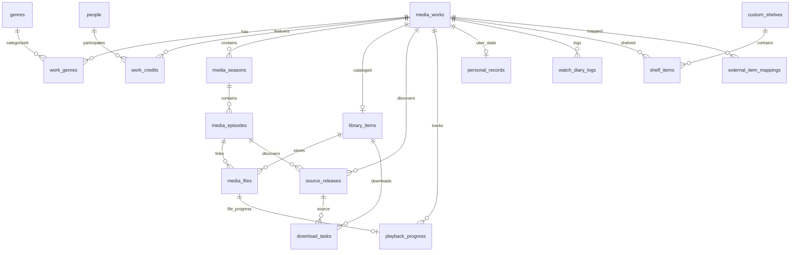

# مدل دادهٔ رابطه‌ای و قواعد پایگاه‌داده (CinemaShelf Relational Data Model)

این سند توصیف‌کنندهٔ ساختار کامل جداول، کلیدهای اصلی/خارجی، اندیس‌ها، قیود یکتایی و روابط موجود در پایگاه‌دادهٔ CinemaShelf مبتنی بر **SQLAlchemy 2.0 Typed Declarative** و مدیریت مهاجرت با **Alembic** است.

---

## ۱. نمای کلی و استراتژی ماژولار

پایگاه‌دادهٔ CinemaShelf بر محور ماژول بنیادی کاتالوگ (`metadata`) و ماژول‌های اقماری (`library`، `sources`، `playback`، `personal` و `integrations`) سازمان‌دهی شده است:

---

## ۲. مشخصات موجودیت‌ها بر اساس ماژول

### ۲.۱. ماژول متادیتا (`app/modules/metadata/models.py`)

این ماژول هویت بین‌المللی و عمومی اثر (`MediaWork`) را بر اساس **TMDB API v3** (ارائه‌دهندهٔ اصلی) و **OMDb API** (ارائه‌دهندهٔ فرعی امتیازها) ذخیره می‌کند.

#### جدول `media_works`
هستهٔ هویتی فیلم‌ها و سریال‌ها در سامانه.
- `id` (PK, Integer, autoincrement): شناسهٔ داخلی اثر.
- `work_type` (Enum: `MOVIE`, `SHOW`, indexed): نوع اثر هنری.
- `tmdb_id` (Integer, unique, indexed, non-null): شناسهٔ یکتای فیلم/سریال در سامانهٔ TMDB.
- `imdb_id` (String(32), unique, indexed, nullable): شناسهٔ استاندارد IMDb (مثال: `"tt1375666"`).
- `title` (String(500), indexed, non-null): عنوان اصلی/انگلیسی اثر.
- `original_title` (String(500), nullable): عنوان به زبان مادری تولید اثر.
- `persian_title` (String(500), nullable): عنوان فارسی رسمی یا رایج.
- `original_language` (String(10), nullable): کد زبان اصلی (مانند `"en"`, `"fa"`).
- `overview` (Text, nullable): خلاصهٔ داستان رسمی.
- `release_date` (Date, nullable): تاریخ عرضه/اکران عمومی.
- `release_year` (Integer, indexed, nullable): سال تولید/انتشار برای جست‌وجو و فیلتر سریع.
- `runtime_minutes` (Integer, nullable): مدت زمان به دقیقه.
- `status` (String(50), nullable): وضعیت اثر (مانند `"Released"`, `"Ended"`, `"Returning Series"`).
- `poster_path` (String(500), nullable): مسیر نسبی پوستر رسمی روی CDN یا کش لوکال.
- `backdrop_path` (String(500), nullable): مسیر تصویر پس‌زمینه (Fanart/Backdrop).
- `tmdb_rating` (Float, nullable): میانگین امتیاز TMDB (از ۱۰).
- `tmdb_vote_count` (Integer, nullable): تعداد آرای ثبت‌شده در TMDB.
- `imdb_rating` (Float, nullable): امتیاز IMDb دریافتی از OMDb (از ۱۰).
- `imdb_votes` (Integer, nullable): تعداد آرای ثبت‌شده در IMDb.
- `rotten_tomatoes_score` (Integer, nullable): درصد امتیاز منتقدان راتن تومیتوز (۰ تا ۱۰۰).
- `metascore` (Integer, nullable): نمرهٔ متاکریتیک (۰ تا ۱۰۰).
- `last_synced_at` (DateTime(timezone=True), nullable): آخرین زمان به‌روزرسانی موفق از ارائه‌دهندگان.
- `created_at` / `updated_at` (DateTime(timezone=True), UTC).

#### جداول `genres` و `work_genres`
دسته‌بندی و ژانرهای رسمی سینمایی و تلویزیونی.
- **`genres`**:
  - `id` (PK, Integer, autoincrement)
  - `tmdb_genre_id` (Integer, unique, indexed, non-null)
  - `name` (String(100), unique, non-null)
  - `persian_name` (String(100), nullable)
  - `created_at` / `updated_at`
- **`work_genres`**:
  - `id` (PK, Integer, autoincrement)
  - `work_id` (FK -> `media_works.id`, ondelete="CASCADE", indexed)
  - `genre_id` (FK -> `genres.id`, ondelete="CASCADE", indexed)
  - `UniqueConstraint("work_id", "genre_id", name="uq_work_genres_work_genre")`

#### جداول `people` و `work_credits`
مدیریت بازیگران، کارگردانان و عوامل فنی اثر به‌صورت کاملاً رابطه‌ای برای جست‌وجوی آثار بر اساس نام شخص یا نقش:
- **`people`**:
  - `id` (PK, Integer, autoincrement)
  - `tmdb_person_id` (Integer, unique, indexed, non-null)
  - `imdb_person_id` (String(32), unique, indexed, nullable)
  - `name` (String(255), indexed, non-null)
  - `original_name` (String(255), nullable)
  - `persian_name` (String(255), nullable)
  - `known_for_department` (String(100), nullable)
  - `profile_path` (String(500), nullable)
- **`work_credits`**:
  - `id` (PK, Integer, autoincrement)
  - `work_id` (FK -> `media_works.id`, ondelete="CASCADE", indexed)
  - `person_id` (FK -> `people.id`, ondelete="CASCADE", indexed)
  - `tmdb_credit_id` (String(100), unique, indexed, nullable)
  - `credit_type` (Enum: `CAST`, `CREW`, indexed)
  - `department` (String(100), indexed): دپارتمان تخصصی (`"Acting"`, `"Directing"`, `"Writing"`, `"Sound"`, `"Camera"`)
  - `job` (String(100), indexed): عنوان نقش (`"Actor"`, `"Director"`, `"Writer"`, `"Original Music Composer"`, `"Editor"`)
  - `character_name` (String(255), nullable): نام کاراکتر برای بازیگران
  - `billing_order` (Integer, nullable): ترتیب تیتراژ بازیگران (Order)
  - `Index("ix_work_credits_person_credit_type_job", "person_id", "credit_type", "job")`

#### جداول `media_seasons` و `media_episodes`
فصل‌ها و قسمت‌های سریال‌های تلویزیونی:
- **`media_seasons`**:
  - `id` (PK, Integer, autoincrement)
  - `work_id` (FK -> `media_works.id`, ondelete="CASCADE", indexed)
  - `tmdb_season_id` (Integer, unique, nullable)
  - `season_number` (Integer, non-null)
  - `title` (String(255), nullable)
  - `overview` (Text, nullable)
  - `poster_path` (String(500), nullable)
  - `air_date` (Date, nullable)
  - `episode_count` (Integer, nullable)
  - `UniqueConstraint("work_id", "season_number", name="uq_media_seasons_work_season")`
- **`media_episodes`**:
  - `id` (PK, Integer, autoincrement)
  - `work_id` (FK -> `media_works.id`, ondelete="CASCADE", indexed)
  - `season_id` (FK -> `media_seasons.id`, ondelete="CASCADE", indexed)
  - `tmdb_episode_id` (Integer, unique, nullable)
  - `season_number` (Integer, non-null)
  - `episode_number` (Integer, non-null)
  - `title` (String(255), nullable)
  - `overview` (Text, nullable)
  - `air_date` (Date, nullable)
  - `runtime_minutes` (Integer, nullable)
  - `still_path` (String(500), nullable)
  - `tmdb_rating` (Float, nullable)
  - `UniqueConstraint("work_id", "season_number", "episode_number", name="uq_media_episodes_work_season_ep")`

---

### ۲.۲. ماژول کتابخانه (`app/modules/library/models.py`)

این ماژول وضعیت موجود بودن اثر در آرشیو کاربر و فایل‌های فیزیکی ذخیره‌شده را مدیریت می‌کند.

#### جدول `library_items`
رابطهٔ ۱ به ۱ با `MediaWork`.
- `id` (PK, Integer, autoincrement)
- `work_id` (FK -> `media_works.id`, ondelete="CASCADE", unique, indexed)
- `status` (Enum: `WANTED`, `DOWNLOADING`, `AVAILABLE`, `PARTIAL`, `MISSING`, `ARCHIVED`, indexed)
- `root_folder_path` (String(1000), nullable)
- `added_at` (DateTime(timezone=True), non-null)

#### جدول `media_files`
فایل‌های فیزیکی موجود روی دیسک (پشتیبانی از چند کیفیت از یک فیلم یا فایل‌های اپیزودیک سریال).
- `id` (PK, Integer, autoincrement)
- `library_item_id` (FK -> `library_items.id`, ondelete="CASCADE", indexed)
- `episode_id` (FK -> `media_episodes.id`, ondelete="SET NULL", nullable, indexed)
- `file_path` (String(1000), unique, indexed, non-null): مسیر مطلق فایل روی دیسک.
- `file_name` (String(500), non-null)
- `file_size_bytes` (BigInteger, nullable)
- `resolution` (String(50), nullable): کیفیت تصویر (`"1080p"`, `"2160p"`, ...)
- `video_codec` (String(50), nullable): کدک ویدیو (`"x265"`, `"x264"`, ...)
- `source_type` (String(50), nullable): منبع دیسک (`"BluRay"`, `"WEB-DL"`, ...)
- `audio_languages` (JSON, nullable): آرایه‌ای از کدهای زبان صوتی
- `subtitle_paths` (JSON, nullable): لیست مسیر فایل‌های زیرنویس مرتبط
- `has_soft_sub` (Boolean, default=False)
- `is_missing` (Boolean, default=False, indexed)
- `last_verified_at` (DateTime(timezone=True), nullable)

---

### ۲.۳. ماژول منابع و دانلود (`app/modules/sources/models.py` و `app/modules/downloads/models.py`)

مدیریت لینک‌های استخراج‌شده و فرآیند دانلود با موتور Aria2.

#### جدول `source_releases`
لینک‌های کشف‌شده از وب‌سایت‌های منبع (مانند زرفیلم یا لینک دستی):
- `id` (PK, Integer, autoincrement)
- `work_id` (FK -> `media_works.id`, ondelete="CASCADE", indexed)
- `episode_id` (FK -> `media_episodes.id`, ondelete="CASCADE", nullable, indexed)
- `provider` (Enum: `ZARFILM`, `MANUAL`, indexed)
- `source_page_url` (String(1000), nullable)
- `download_url` (Text, non-null)
- `quality_label` (String(255), nullable)
- `resolution` (String(50), nullable)
- `encoder` (String(100), nullable)
- `size_text` (String(50), nullable)
- `size_bytes` (BigInteger, nullable)
- `is_dubbed` (Boolean, default=False)
- `has_persian_sub` (Boolean, default=False)
- `discovered_at` (DateTime(timezone=True), non-null)

#### جدول `download_tasks`
وظایف دانلود فعال یا تکمیل‌شدهٔ Aria2:
- `id` (PK, Integer, autoincrement)
- `library_item_id` (FK -> `library_items.id`, ondelete="CASCADE", indexed)
- `episode_id` (FK -> `media_episodes.id`, ondelete="SET NULL", nullable, indexed)
- `release_id` (FK -> `source_releases.id`, ondelete="SET NULL", nullable, indexed)
- `aria2_gid` (String(64), unique, indexed, nullable)
- `download_url` (Text, non-null)
- `destination_dir` (String(1000), non-null)
- `file_name` (String(500), nullable)
- `status` (Enum: `QUEUED`, `ACTIVE`, `PAUSED`, `COMPLETED`, `ERROR`, `REMOVED`, indexed)
- `total_bytes` (BigInteger, nullable)
- `downloaded_bytes` (BigInteger, default=0, non-null)
- `progress_percent` (Float, default=0.0)
- `download_speed_bps` (BigInteger, default=0)
- `error_message` (Text, nullable)
- `started_at` / `completed_at` (DateTime(timezone=True), nullable)

---

### ۲.۴. ماژول پخش (`app/modules/playback/models.py`)

#### جدول `playback_progress`
ردیابی موقعیت ادامهٔ پخش (Resume Position):
- `id` (PK, Integer, autoincrement)
- `work_id` (FK -> `media_works.id`, ondelete="CASCADE", indexed)
- `episode_id` (FK -> `media_episodes.id`, ondelete="CASCADE", nullable, indexed)
- `media_file_id` (FK -> `media_files.id`, ondelete="SET NULL", unique, nullable)
- `position_seconds` (Integer, default=0)
- `duration_seconds` (Integer, nullable)
- `progress_percent` (Float, default=0.0)
- `is_completed` (Boolean, default=False, indexed)
- `last_watched_at` (DateTime(timezone=True), indexed, non-null)

---

### ۲.۵. ماژول ردیابی شخصی (`app/modules/personal/models.py`)

داده‌های اختصاصی کاربر که متعلق به اثر است، فارغ از اینکه فایل آن دانلود شده باشد یا خیر.

#### جدول `personal_records`
وضعیت تماشا و امتیاز اختصاصی کاربر برای اثر:
- `id` (PK, Integer, autoincrement)
- `work_id` (FK -> `media_works.id`, ondelete="CASCADE", unique, indexed)
- `watch_status` (Enum: `UNWATCHED`, `WATCHLIST`, `WATCHING`, `COMPLETED`, `ON_HOLD`, `DROPPED`, indexed)
- `in_watchlist` (Boolean, default=False, indexed)
- `is_favorite` (Boolean, default=False, indexed)
- `user_rating` (Float, nullable): امتیاز کاربر (مثلاً مقیاس ۰.۵ تا ۵.۰ یا ۱ تا ۱۰)
- `watch_count` (Integer, default=0)
- `personal_notes` (Text, nullable)
- `first_watched_at` (Date, nullable)
- `last_watched_at` (Date, nullable)

#### جدول `watch_diary_logs`
ثبت تاریخچه و دفترچهٔ خاطرات تماشا و بازبینی (Letterboxd Diary style):
- `id` (PK, Integer, autoincrement)
- `work_id` (FK -> `media_works.id`, ondelete="CASCADE", indexed)
- `episode_id` (FK -> `media_episodes.id`, ondelete="CASCADE", nullable, indexed)
- `watched_date` (Date, indexed, non-null)
- `rating_at_time` (Float, nullable)
- `is_rewatch` (Boolean, default=False)
- `review_text` (Text, nullable)
- `liked` (Boolean, default=False)

#### جداول `custom_shelves` و `shelf_items`
قفسه‌ها و کالکشن‌های سفارشی ایجادشده توسط کاربر:
- **`custom_shelves`**:
  - `id` (PK, Integer, autoincrement)
  - `name` (String(255), unique, non-null)
  - `slug` (String(255), unique, indexed, non-null)
  - `description` (Text, nullable)
  - `is_smart_shelf` (Boolean, default=False)
- **`shelf_items`**:
  - `id` (PK, Integer, autoincrement)
  - `shelf_id` (FK -> `custom_shelves.id`, ondelete="CASCADE", indexed)
  - `work_id` (FK -> `media_works.id`, ondelete="CASCADE", indexed)
  - `rank_order` (Integer, default=0)
  - `note` (Text, nullable)
  - `added_at` (DateTime(timezone=True), non-null)
  - `UniqueConstraint("shelf_id", "work_id", name="uq_shelf_items_shelf_work")`

---

### ۲.۶. ماژول یکپارچه‌سازی و همگام‌سازی (`app/modules/integrations/models.py`)

#### جدول `integration_sync_runs`
لاگ و گزارش دوره‌های اجرای همگام‌سازی بیرونی (مانند Letterboxd، TMDB و OMDb):
- `id` (PK, Integer, autoincrement)
- `provider` (Enum: `LETTERBOXD`, `TMDB`, `OMDB`, indexed)
- `sync_type` (String(100), non-null): نوع همگام‌سازی (مانند `"WATCHLIST"`, `"DIARY"`, `"RATINGS"`, `"METADATA_REFRESH"`)
- `status` (Enum: `RUNNING`, `SUCCESS`, `PARTIAL`, `FAILED`, indexed)
- `items_processed` / `items_created` / `items_updated` / `items_failed` (Integer)
- `error_details` (JSON, nullable)
- `started_at` / `finished_at` (DateTime(timezone=True))

#### جدول `external_item_mappings`
جدول تطبیق پایدار (Idempotent) میان شناسه‌های سامانه‌های بیرونی و `MediaWork`:
- `id` (PK, Integer, autoincrement)
- `provider` (Enum: `LETTERBOXD`, `TMDB`, `OMDB`, indexed)
- `external_key` (String(500), indexed, non-null): کلید بیرونی مانند URI فیلم در لترباکسد
- `work_id` (FK -> `media_works.id`, ondelete="CASCADE", indexed)
- `last_synced_hash` (String(64), nullable)
- `last_synced_at` (DateTime(timezone=True), non-null)
- `UniqueConstraint("provider", "external_key", name="uq_external_mappings_provider_key")`

---

## ۳. قواعد و ثوابت دامنه‌ای پایگاه‌داده

1. **تفکیک هویت اثر (`MediaWork`) از فایل فیزیکی (`MediaFile`):**
   یک اثر ممکن است دارای فایل‌های متعددی با کیفیت‌های متفاوت (مانند ۱۰۸۰p و ۴K) باشد یا اصلاً هنوز دانلودی برای آن ثبت نشده باشد (`WANTED`). تمام داده‌های کاربری و امتیازها به `MediaWork` پیوند می‌خورند.
2. **یکتایی و عدم بازتولید رکوردهای تکراری:**
   شناسه‌های معتبر بین‌المللی (`tmdb_id`, `imdb_id`, `aria2_gid`) دارای قیدهای `UniqueConstraint` و `Index` هستند تا از ثبت رکوردهای تکراری در پردازش‌های ناهمگام و تکراری جلوگیری شود.
3. **پایداری داده در قطع منبع (Source Offline):**
   قطع درایو اکسترنال هرگز منجر به حذف رکورد `MediaFile` نمی‌شود؛ بلکه وضعیت `is_missing` صرفاً در صورت اسکن موفق و غیبت قطعی فایل تغییر می‌یابد.
4. **زمان‌بندی UTC استاندارد:**
   تمام زمان‌ها به‌صورت UTC استاندارد با `DateTime(timezone=True)` و پیش‌فرض‌های لحظه‌ای (`server_default=func.now()`) ثبت می‌گردند.
