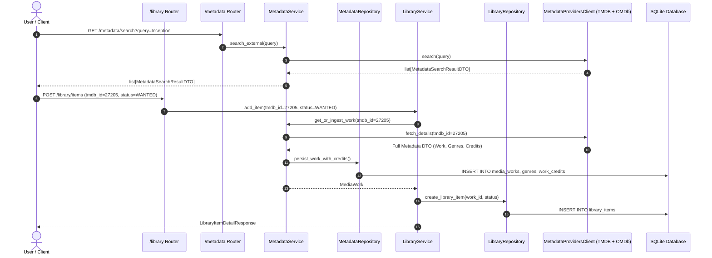

# Implementation Plan - Phase 1: Core Data, Library & Metadata Catalog

This plan establishes the vertical slice for **Phase 1** of CinemaShelf as outlined in [`docs/11-implementation-roadmap-fa.md`](../11-implementation-roadmap-fa.md). It delivers the external metadata provider adapter (TMDB + OMDb), metadata catalog services/APIs, and local library management services/APIs.

---

## Goal Description
Enable searching for films and TV shows via external metadata providers (TMDB API v3 and OMDb API), ingesting normalized records (works, genres, cast/crew credits, seasons/episodes) into the local SQLite database, and managing local library records (`LibraryItem` and `MediaFile`) through clean FastAPI REST endpoints.

---

## User Review Required

> [!IMPORTANT]
> **API Keys & Offline Fallback Strategy:**
> If `TMDB_API_KEY` or `OMDB_API_KEY` are empty in `.env`, the metadata provider client will raise `ProviderUnavailableError` (HTTP 503) during live searches, with comprehensive fixture stubs provided for unit/integration tests. We also provide a mock/fixture provider mode for tests to run without network access.

> [!NOTE]
> **Workflow for Adding Works to Library:**
> We propose two clean flows:
> 1. **Modular 2-Step Flow:** `POST /metadata/fetch/{tmdb_id}` (ingests metadata) -> `POST /library/items` (creates `LibraryItem` with `work_id`).
> 2. **Convenience 1-Step Flow:** `POST /library/items` accepts an optional `tmdb_id` and automatically ensures the `MediaWork` is ingested if not already present.

---

## Architectural Workflow & Component Relationships

---

## Proposed Changes

### 1. External Adapter: `app/adapters/metadata_providers/`

#### [MODIFY] `app/adapters/metadata_providers/client.py`
- Define strong DTOs for external metadata:
  - `ExternalSearchResult(tmdb_id, title, original_title, release_year, overview, poster_path, work_type)`
  - `ExternalWorkDetails(tmdb_id, imdb_id, title, original_title, persian_title, overview, release_date, runtime_minutes, status, poster_path, backdrop_path, tmdb_rating, tmdb_vote_count, genres, credits, seasons)`
  - `ExternalCredit(person_tmdb_id, person_imdb_id, name, department, job, credit_type, character_name, billing_order, profile_path)`
- Define `MetadataProvidersPort(Protocol)`:
  - `search_works(query: str, release_year: int | None = None, work_type: str = "MOVIE") -> list[ExternalSearchResult]`
  - `fetch_work_details(tmdb_id: int, work_type: str = "MOVIE") -> ExternalWorkDetails`
  - `fetch_omdb_ratings(imdb_id: str) -> dict[str, Any]` (IMDb rating, Rotten Tomatoes %, Metascore)
- Implement `MetadataProvidersClient(MetadataProvidersPort)` using `httpx.AsyncClient`:
  - TMDB endpoints: `/search/movie`, `/search/tv`, `/movie/{id}?append_to_response=credits,external_ids`, `/tv/{id}?append_to_response=credits,external_ids`.
  - OMDb endpoint: `/?i={imdb_id}&apikey={key}`.
  - Rate limiting, error handling mapping to `ProviderUnavailableError`.

---

### 2. Metadata Module: `app/modules/metadata/`

#### [MODIFY] `app/modules/metadata/schemas.py`
- Pydantic models for API serialization:
  - `GenreResponse(id, tmdb_genre_id, name, persian_name)`
  - `PersonResponse(id, tmdb_person_id, name, known_for_department, profile_path)`
  - `WorkCreditResponse(id, person, credit_type, department, job, character_name, billing_order)`
  - `MediaEpisodeResponse(id, season_number, episode_number, title, overview, air_date, runtime_minutes, still_path, tmdb_rating)`
  - `MediaSeasonResponse(id, season_number, title, overview, poster_path, air_date, episode_count, episodes)`
  - `MediaWorkSummaryResponse(id, work_type, tmdb_id, imdb_id, title, original_title, release_year, runtime_minutes, poster_path, tmdb_rating, imdb_rating, rotten_tomatoes_score)`
  - `MediaWorkDetailResponse(MediaWorkSummaryResponse)`: includes `genres`, `credits`, `seasons`.
  - `ExternalSearchResponse`: wrapper for search results.
  - `IngestWorkRequest(tmdb_id: int, work_type: WorkType = WorkType.MOVIE)`.

#### [MODIFY] `app/modules/metadata/repository.py`
- Persistence operations without committing:
  - `get_work_by_id(work_id: int) -> MediaWork | None`
  - `get_work_by_tmdb_id(tmdb_id: int, work_type: WorkType) -> MediaWork | None`
  - `get_work_by_imdb_id(imdb_id: str) -> MediaWork | None`
  - `list_works(limit: int = 50, offset: int = 0, work_type: WorkType | None = None, release_year: int | None = None, search: str | None = None) -> list[MediaWork]`
  - `get_or_create_genre(tmdb_genre_id: int, name: str, persian_name: str | None = None) -> Genre`
  - `get_or_create_person(tmdb_person_id: int, name: str, imdb_person_id: str | None = None, known_for_department: str | None = None, profile_path: str | None = None) -> Person`
  - `create_work(work: MediaWork) -> MediaWork`
  - `get_person_filmography(person_id: int, job: str | None = None) -> list[MediaWork]`

#### [MODIFY] `app/modules/metadata/service.py`
- Service orchestration and transaction ownership:
  - `search_external(query: str, release_year: int | None = None, work_type: WorkType = WorkType.MOVIE) -> list[ExternalSearchResult]`
  - `get_or_ingest_work(tmdb_id: int, work_type: WorkType = WorkType.MOVIE) -> MediaWork`:
    - Checks repository first.
    - If absent, calls `MetadataProvidersPort.fetch_work_details()`.
    - Enriches with OMDb external ratings via `fetch_omdb_ratings(imdb_id)`.
    - Resolves/creates `Genre` and `WorkGenre` associations.
    - Filters top 20 cast (`billing_order < 20`) and key crew roles (`Director`, `Writer`, `Screenplay`, `Story`, `Composer`, `Director of Photography`, `Editor`).
    - Resolves/creates `Person` and `WorkCredit`.
    - If TV show, builds `MediaSeason` and `MediaEpisode` hierarchy.
    - Commits transaction atomically.
  - `get_work(work_id: int) -> MediaWork`
  - `list_works(...) -> list[MediaWork]`
  - `get_person_credits(person_id: int)`

#### [MODIFY] `app/modules/metadata/router.py`
- HTTP endpoints:
  - `GET /metadata/search`: Query external providers.
  - `POST /metadata/ingest`: Ingest work by `tmdb_id` and `work_type`.
  - `GET /metadata/works`: List and filter locally cached works.
  - `GET /metadata/works/{id}`: Detailed work response with genres and credits.
  - `GET /metadata/people/{id}/filmography`: Query works associated with person.

---

### 3. Library Module: `app/modules/library/`

#### [MODIFY] `app/modules/library/schemas.py`
- Pydantic models:
  - `MediaFileCreate(file_path: str, file_name: str, file_size_bytes: int | None, resolution: str | None, video_codec: str | None, source_type: str | None, audio_languages: list[str] | None, episode_id: int | None)`
  - `MediaFileResponse(id, library_item_id, episode_id, file_path, file_name, file_size_bytes, resolution, video_codec, source_type, is_missing, created_at)`
  - `LibraryItemCreate(work_id: int | None = None, tmdb_id: int | None = None, work_type: WorkType = WorkType.MOVIE, status: LibraryItemStatus = LibraryItemStatus.WANTED, root_folder_path: str | None = None)`
  - `LibraryItemStatusUpdate(status: LibraryItemStatus)`
  - `LibraryItemSummaryResponse(id, work_id, status, root_folder_path, added_at, files_count)`
  - `LibraryItemDetailResponse(id, work_id, status, root_folder_path, added_at, work: MediaWorkSummaryResponse, media_files: list[MediaFileResponse])`

#### [MODIFY] `app/modules/library/repository.py`
- Persistence operations without committing:
  - `get_item_by_id(item_id: int) -> LibraryItem | None`
  - `get_item_by_work_id(work_id: int) -> LibraryItem | None`
  - `list_items(status: LibraryItemStatus | None = None, limit: int = 50, offset: int = 0) -> list[LibraryItem]`
  - `create_item(item: LibraryItem) -> LibraryItem`
  - `delete_item(item: LibraryItem) -> None`
  - `add_media_file(media_file: MediaFile) -> MediaFile`
  - `get_media_file_by_path(file_path: str) -> MediaFile | None`

#### [MODIFY] `app/modules/library/service.py`
- Service orchestration and transaction ownership:
  - `add_to_library(request: LibraryItemCreate) -> LibraryItem`:
    - If `work_id` not provided, calls `MetadataService.get_or_ingest_work(tmdb_id, work_type)`.
    - Checks if `LibraryItem` already exists (raises conflict or returns existing).
    - Persists `LibraryItem` with initial status (`WANTED`, `AVAILABLE`, etc.).
    - Commits transaction.
  - `update_status(item_id: int, status: LibraryItemStatus) -> LibraryItem`
  - `attach_media_file(item_id: int, file_data: MediaFileCreate) -> MediaFile`
  - `get_library_item(item_id: int) -> LibraryItem`
  - `list_library_items(status: LibraryItemStatus | None, limit: int, offset: int) -> list[LibraryItem]`

#### [MODIFY] `app/modules/library/router.py`
- HTTP endpoints:
  - `POST /library/items`: Add film/show to library.
  - `GET /library/items`: List library items with status filter.
  - `GET /library/items/{id}`: Detailed library item with media files and work summary.
  - `PATCH /library/items/{id}/status`: Transition library item status.
  - `POST /library/items/{id}/files`: Attach a physical media file.

---

### 4. Application Wiring: `app/main.py` & `app/bootstrap.py`

#### [MODIFY] `app/main.py`
- Register `metadata_router` and `library_router` onto the FastAPI app instance.
- Ensure dependency injection routes `get_db_session` properly.

---

## Verification Plan

### Automated Tests
1. **Adapter Tests (`tests/unit/test_metadata_adapter.py`)**:
   - Mock TMDB and OMDb HTTP responses (sample payloads for *Inception* and *Breaking Bad*).
   - Test search parsing, credit truncation (top 20 cast, key crew jobs), and OMDb ratings enrichment.
   - Test error handling when TMDB returns 404 or connection fails (`ProviderUnavailableError`).
2. **Metadata Service & Repository Tests (`tests/unit/test_metadata_service.py`)**:
   - Test `get_or_ingest_work` idempotency: ingesting twice returns existing work without duplicating.
   - Verify genre and credit persistence.
3. **Library Service & Repository Tests (`tests/unit/test_library_service.py`)**:
   - Test adding item to library with `tmdb_id` autoinvestment.
   - Test status update transitions (`WANTED` -> `DOWNLOADING` -> `AVAILABLE`).
   - Test attaching media files and uniqueness of file paths.
4. **End-to-End API Integration Tests (`tests/integration/test_api_phase1.py`)**:
   - Using FastAPI `TestClient(app)`:
     - `GET /metadata/search` (mocked adapter)
     - `POST /metadata/ingest`
     - `POST /library/items`
     - `GET /library/items`
     - `POST /library/items/{id}/files`
5. **Quality & Boundary Verification**:
   - `pytest -v`
   - `ruff check .`
   - `ruff format --check .`
   - `mypy app tests`
   - `tests/architecture/test_no_legacy_imports.py`
