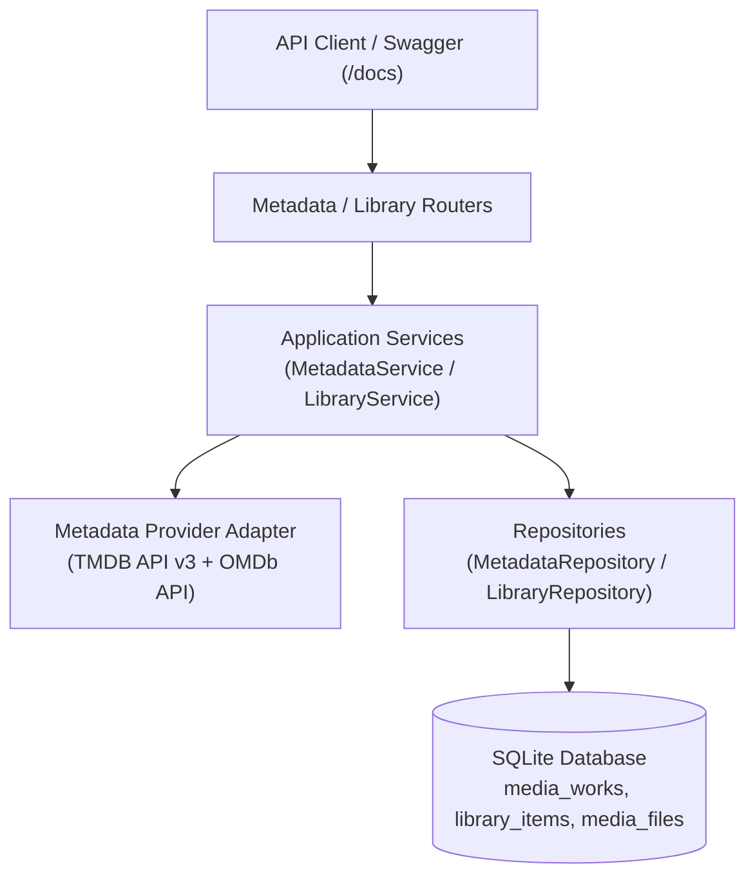

# Walkthrough - Phase 1: Core Data, Library & Metadata Catalog

**Phase 1: Core Data, Library & Metadata Catalog** establishes the database foundation, external metadata integration (TMDB + OMDb), and local library catalog operations.

---

## 1. Architectural Overview

---

## 2. Changes Implemented

### A. Database Models & Schema (SQLAlchemy 2.0 Declarative)
- **Files**:
  - `app/modules/metadata/models.py` (`media_works`, `genres`, `people`, `work_credits`, `media_seasons`, `media_episodes`, `work_genres`)
  - `app/modules/library/models.py` (`library_items`, `media_files`)
- Generated and verified Alembic migration: `migrations/versions/26035cc7635c_initial_schema.py`.

### B. Metadata Provider Adapter (TMDB + OMDb)
- **File**: `app/adapters/metadata_providers/client.py`
- Implemented `MetadataProvidersPort(Protocol)` and `MetadataProvidersClient`.
- Mapped TMDB API v3 endpoints (`/search/movie`, `/search/tv`, `/movie/{id}`, `/tv/{id}`) with `append_to_response=credits,external_ids`.
- Filtered top 20 cast (`order < 20`) and key crew jobs (`Director`, `Writer`, `Screenplay`, `Story`, `Original Music Composer`, `Director of Photography`, `Editor`).
- Enriched metadata with external OMDb ratings (`imdb_rating`, `imdb_votes`, `metascore`, `rotten_tomatoes_score`).

### C. Metadata Catalog Module (`app/modules/metadata/`)
- **Schemas**: `app/modules/metadata/schemas.py`
  - Defined Pydantic models for genres, persons, credits, episodes, seasons, work summaries, and detailed views.
- **Repository**: `app/modules/metadata/repository.py`
  - Implemented `get_work_by_id`, `get_work_by_tmdb_id`, `get_work_by_imdb_id`, `list_works`, `get_or_create_genre`, `get_or_create_person`, `create_work`, `get_person_filmography`.
- **Service**: `app/modules/metadata/service.py`
  - Managed database transactions (`commit()` / `rollback()`).
  - Implemented `search_external` and idempotent `get_or_ingest_work`.
  - Normalized and linked genres, people, credits, seasons, and episodes.
- **Router**: `app/modules/metadata/router.py`
  - `GET /metadata/search`: Searches TMDB for movies or TV series.
  - `POST /metadata/ingest`: Fetches details and ingests into local catalog.
  - `GET /metadata/works`: Lists works with filters (`limit`, `offset`, `work_type`, `release_year`, `search`).
  - `GET /metadata/works/{id}`: Detailed work response.
  - `GET /metadata/people/{id}/filmography`: Query works associated with a specific person.

### D. Library Management Module (`app/modules/library/`)
- **Schemas**: `app/modules/library/schemas.py`
  - Defined `LibraryItemCreate`, `LibraryItemSummaryResponse`, `LibraryItemDetailResponse`, `LibraryItemStatusUpdate`, `MediaFileCreate`, `MediaFileResponse`.
- **Repository**: `app/modules/library/repository.py`
  - Implemented `get_item_by_id`, `get_item_by_work_id`, `list_items`, `create_item`, `delete_item`, `add_media_file`, `get_media_file_by_path`.
- **Service**: `app/modules/library/service.py`
  - Implemented `add_to_library` supporting both direct `work_id` and automatic metadata ingestion via `tmdb_id`.
  - Prevented duplicate catalog entries (HTTP 409 `item_already_in_library`).
  - Implemented `attach_media_file`, automatically advancing `WANTED` items to `AVAILABLE`.
- **Router**: `app/modules/library/router.py`
  - `POST /library/items`: Add work to library.
  - `GET /library/items`: List library items with status filter (`WANTED`, `AVAILABLE`, etc.).
  - `GET /library/items/{id}`: Detailed library item with physical files.
  - `PATCH /library/items/{id}/status`: Status transition.
  - `POST /library/items/{id}/files`: Attach physical video file.
  - `DELETE /library/items/{id}`: Remove item from library.

---

## 3. Verification & Test Coverage

### Automated Test Suite (24 Tests)
Ran `pytest -v`:
- `tests/architecture/test_no_legacy_imports.py`: PASSED (0 legacy imports across `app/`)
- `tests/unit/test_metadata_adapter.py`: PASSED (TMDB search, credit filtering, OMDb rating enrichment, error handling)
- `tests/unit/test_metadata_service.py`: PASSED (Search delegation, idempotent ingestion, 404 handling, filmography queries)
- `tests/unit/test_library_service.py`: PASSED (Add via `work_id`, add via `tmdb_id`, duplicate conflict, file attachment and auto-status update)
- `tests/integration/test_api_phase1.py`: PASSED (Full end-to-end HTTP lifecycle via `TestClient`)
- `tests/integration/test_models.py`: PASSED (ORM cascade deletes, relationships, unique constraints)
- `tests/integration/test_db_session.py`: PASSED
- `tests/unit/test_health.py`: PASSED
