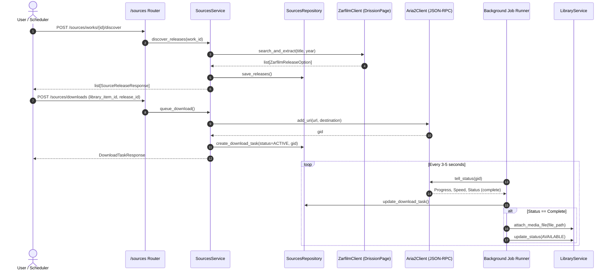

# Implementation Plan - Phase 2: Sources & Download Pipeline

This plan defines the architecture, adapters, domain services, APIs, and background job engine for **Phase 2** of CinemaShelf, based on [`docs/11-implementation-roadmap-fa.md`](../11-implementation-roadmap-fa.md) and the reference implementation from `../zarfilm-night-scheduler`.

---

## Goal Description
Enable finding video releases and direct download links for movies from Zarfilm using browser automation (`DrissionPage`), managing downloads via Aria2 JSON-RPC (start, pause, resume, cancel, speed limit, status polling), and running a controlled background worker (`app/jobs/runner.py`) for live download progress monitoring and JIT (Just-In-Time) / nightly queue processing.

---

## User Review Required

> [!IMPORTANT]
> **Aria2 JSON-RPC & Daemon Launching:**
> The adapter interacts with Aria2 over its standard JSON-RPC 2.0 interface (`POST http://127.0.0.1:6800/jsonrpc`). If the local daemon is not running, the adapter can automatically spawn `aria2c --enable-rpc ...` into the configured download directory (`~/Movies/Zarfilm` or `./data/downloads`).

> [!NOTE]
> **DrissionPage & Headless Execution:**
> `DrissionPage` requires Chromium and persists login cookies/state in `Settings.zarfilm_profile_dir` (`./data/profiles/zarfilm`). In automated tests, all browser calls and Aria2 RPC calls will be mocked using standard protocols so tests run offline, fast, and reliably without requiring live browser launches.

---

## Architectural Workflow & Component Relationships

---

## Proposed Changes

### 1. Central Configuration: `app/core/config.py`

#### [MODIFY] `app/core/config.py`
- Add settings for Aria2, Zarfilm, and download scheduling:
  - `zarfilm_base_url: str = "https://zarfilm.com"`
  - `download_dir: Path = Path("./data/downloads")`
  - `preferred_quality: str = "1080p"`
  - `prefer_x265: bool = True`
  - `max_concurrent_downloads: int = 2`
  - `scheduler_start_hour: int = 2`
  - `scheduler_end_hour: int = 7`
  - `scheduler_enabled: bool = True`
  - `scheduler_force_run: bool = False`
- Ensure `download_dir` is created in `ensure_directories()`.

---

### 2. External Adapters: `app/adapters/`

#### [MODIFY] `app/adapters/aria2/client.py`
Port the functionality from `zarfilm-night-scheduler/app/aria_manager.py` using typed JSON-RPC:
- Dataclass `Aria2TaskStatus`:
  - `gid: str`, `status: str` (`active`, `waiting`, `paused`, `error`, `complete`, `removed`)
  - `total_length_bytes: int`, `completed_length_bytes: int`, `download_speed_bps: int`
  - `progress_percent: float`, `file_path: str | None`, `file_name: str | None`, `error_message: str | None`
- Dataclass `Aria2GlobalStats`:
  - `download_speed_bps: int`, `upload_speed_bps: int`, `num_active: int`, `num_waiting: int`, `num_stopped: int`
- Protocol `Aria2Port(Protocol)`:
  - `is_daemon_running() -> bool`
  - `start_local_daemon() -> bool`
  - `add_uri(url: str, destination_dir: str, file_name: str | None = None) -> str`
  - `tell_status(gid: str) -> Aria2TaskStatus`
  - `tell_active() -> list[Aria2TaskStatus]`
  - `pause(gid: str) -> bool`
  - `unpause(gid: str) -> bool`
  - `remove(gid: str) -> bool`
  - `pause_all() -> bool`
  - `resume_all() -> bool`
  - `get_global_stats() -> Aria2GlobalStats`
  - `set_speed_limit(limit_kb: int) -> bool`

#### [MODIFY] `app/adapters/zarfilm/client.py`
Port Zarfilm browser scraping logic from `zarfilm-night-scheduler/app/scraper.py`:
- Protocol `ZarfilmPort(Protocol)`:
  - `search_cards(title: str, year: int | str | None = None) -> list[ZarfilmMovieCard]`
  - `match_card(cards: list[ZarfilmMovieCard], title: str, year: int | str | None = None) -> ZarfilmMovieCard | None`
  - `extract_releases(movie_page_url: str) -> list[ZarfilmReleaseCandidate]`
  - `search_and_extract(title: str, year: int | str | None = None) -> tuple[str | None, list[ZarfilmReleaseCandidate]]`
  - `score_candidate(candidate, preferred_quality, prefer_x265) -> int`
  - `pick_best_release(releases, preferred_quality, prefer_x265) -> ZarfilmReleaseCandidate | None`
- Quality scoring algorithm:
  - SoftSub priority: `+20 points`
  - Resolution match: `+10 points`
  - x265/HEVC preference: `+5 points`

---

### 3. Sources Module: `app/modules/sources/`

#### [MODIFY] `app/modules/sources/schemas.py`
- Pydantic models:
  - `SourceReleaseResponse(id, work_id, provider, download_url, quality_label, resolution, size_text, has_persian_sub, is_dubbed)`
  - `SourceReleaseCreate(...)`
  - `DownloadTaskCreate(library_item_id, release_id, download_url, destination_dir, file_name)`
  - `DownloadTaskResponse(id, library_item_id, release_id, aria2_gid, status, total_bytes, downloaded_bytes, progress_percent, download_speed_bps, error_message)`
  - `SpeedLimitRequest(max_download_limit_kb: int)`
  - `Aria2StatsResponse(download_speed, upload_speed, num_active, num_waiting, num_stopped)`
  - `DiscoverReleasesResponse(work_id, source_page_url, total_found, releases)`

#### [MODIFY] `app/modules/sources/repository.py`
- Persistence operations without committing:
  - `add_release`, `get_release_by_id`, `list_releases_for_work`, `delete_releases_for_work`
  - `create_task`, `get_task_by_id`, `get_task_by_gid`, `list_tasks`, `list_active_tasks`, `count_active_downloads`

#### [MODIFY] `app/modules/sources/service.py`
- Service orchestration and transaction boundaries:
  - `discover_and_save_releases(work_id: int)`
  - `create_download_task(request: DownloadTaskCreate, start_immediately: bool = True)`
  - `pause_download(task_id: int)`, `resume_download(task_id: int)`, `cancel_download(task_id: int)`
  - `get_aria2_stats()`, `set_speed_limit(limit_kb: int)`

#### [MODIFY] `app/modules/sources/router.py`
- REST API endpoints:
  - `POST /sources/works/{id}/discover`
  - `GET /sources/works/{id}/releases`
  - `POST /sources/downloads`
  - `GET /sources/downloads`
  - `GET /sources/downloads/{id}`
  - `POST /sources/downloads/{id}/pause`
  - `POST /sources/downloads/{id}/resume`
  - `DELETE /sources/downloads/{id}`
  - `GET /sources/stats`
  - `POST /sources/speed-limit`

---

### 4. Background Job Engine & Night Scheduler: `app/jobs/`

#### [MODIFY] `app/jobs/handlers.py`
- `is_within_schedule(start_hour, end_hour)`: Validates night schedule window.
- `sync_active_downloads(session, aria2)`: Updates task progress, marks completion, and calls `LibraryService.attach_media_file()`.
- `process_queued_downloads_jit(session, sources_service, max_concurrent)`: Promotes queued downloads during night window.

#### [MODIFY] `app/jobs/runner.py`
- `BackgroundJobRunner`: Periodic daemon thread executing download synchronization and JIT dispatching.

#### [MODIFY] `app/bootstrap.py`
- Wires `BackgroundJobRunner.start()` and `stop()` into application lifespan.
