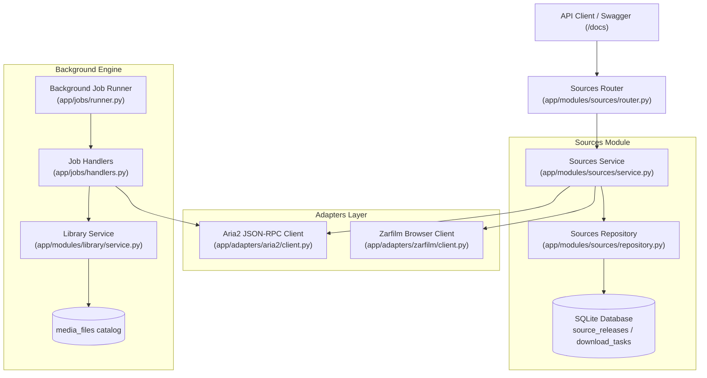

# Walkthrough - Phase 2: Sources & Download Pipeline

**Phase 2: Sources & Download Pipeline** establishes automated scraping for release candidates from Zarfilm, management of downloads via Aria2 JSON-RPC, and an automated background worker with a JIT night scheduler.

---

## 1. Architectural Overview

---

## 2. Changes Implemented by Component

### A. Zarfilm Browser Scraper Adapter
- **File**: `app/adapters/zarfilm/client.py`
- Implemented `ZarfilmBrowserClient` with `ZarfilmPort(Protocol)` using `DrissionPage`.
- Scrapes search cards (`article.zf-card-movie`) and matches candidates by exact title and year with substring fallback.
- Parses quality boxes (`.item_row_dl`), filtering out audio tracks and extracting SoftSub (`subtitle_link`), dubbed (`double_link`), encoder, and file size.
- **Quality Scoring Algorithm**:
  - **SoftSub (Persian attached subtitle)**: `+20 points` (prioritizes SoftSub over dubbed releases).
  - **Resolution Match** (e.g. `1080p`): `+10 points`.
  - **Codec Preference** (e.g. `x265` / `10bit`): `+5 points`.

### B. Aria2 JSON-RPC Client Adapter
- **File**: `app/adapters/aria2/client.py`
- Implemented `Aria2Client` with `Aria2Port(Protocol)`.
- Robust JSON-RPC 2.0 communication over HTTP with optional secret token authentication (`token:<secret>`).
- Auto-spawns local `aria2c` background daemon if not already running via `start_local_daemon()`.
- Maps RPC errors and connection failures to `ProviderUnavailableError`.
- Strongly typed dataclasses `Aria2TaskStatus` and `Aria2GlobalStats`.

### C. Sources Domain Module (`app/modules/sources/`)
- **Schemas (`app/modules/sources/schemas.py`)**:
  - `SourceReleaseResponse`, `SourceReleaseCreate`, `DiscoverReleasesResponse`.
  - `DownloadTaskCreate`, `DownloadTaskResponse`, `SpeedLimitRequest`, `Aria2StatsResponse`.
- **Repository (`app/modules/sources/repository.py`)**:
  - Clean queries for `SourceRelease` and `DownloadTask` without internal commits (service manages transactions).
- **Service (`app/modules/sources/service.py`)**:
  - `discover_and_save_releases(work_id)`: Searches Zarfilm for the movie and persists candidates.
  - `create_download_task(request, start_immediately)`: Dispatches to Aria2 or queues for night schedule. Automatically promotes `LibraryItem.status = DOWNLOADING`.
  - `pause_download`, `resume_download`, `cancel_download`.
  - `get_aria2_stats`, `set_speed_limit`.
- **Router (`app/modules/sources/router.py`)**:
  - Mounted under prefix `/sources` in `app/main.py`.

#### Endpoints Summary:
| Method | Endpoint | Description |
|---|---|---|
| `POST` | `/sources/works/{id}/discover` | Scrapes Zarfilm for download links and saves releases |
| `GET` | `/sources/works/{id}/releases` | Lists discovered releases for a work |
| `POST` | `/sources/downloads` | Schedules/starts a download task with Aria2 |
| `GET` | `/sources/downloads` | Lists download tasks with status and pagination filters |
| `GET` | `/sources/downloads/{id}` | Gets specific download task progress and details |
| `POST` | `/sources/downloads/{id}/pause` | Pauses active Aria2 download |
| `POST` | `/sources/downloads/{id}/resume` | Resumes paused or starts queued download |
| `DELETE` | `/sources/downloads/{id}` | Cancels and removes download task from Aria2 |
| `GET` | `/sources/stats` | Returns Aria2 global bandwidth and queue counts |
| `POST` | `/sources/speed-limit` | Dynamically adjusts global download speed limit (KB/s) |

### D. Background Worker & JIT Night Scheduler
- **Handlers (`app/jobs/handlers.py`)**:
  - `is_within_schedule(start_hour, end_hour)`: Checks if current time is within schedule (supports overnight wrap-around, e.g. 02:00 to 07:00).
  - `sync_active_downloads(session, aria2)`: Polls active Aria2 downloads, updates bytes and speed, and on completion automatically registers the file in `LibraryService.attach_media_file` and marks `LibraryItem.status = AVAILABLE`.
  - `process_queued_downloads_jit(session, sources_service, max_concurrent)`: Promotes queued tasks to active during night window up to capacity limits.
- **Runner (`app/jobs/runner.py`)**:
  - Thread-safe `BackgroundJobRunner` executing periodic iterations with graceful shutdown.
- **Lifecycle Integration (`app/bootstrap.py`)**:
  - Background runner starts automatically during `startup_app` and terminates cleanly during `shutdown_app`.

---

## 3. Verification & Test Results

### Automated Test Suite (49 Passed)
Ran `pytest -v`:
- `tests/unit/test_aria2_adapter.py`: 7 passed
- `tests/unit/test_zarfilm_adapter.py`: 5 passed
- `tests/unit/test_sources_service.py`: 6 passed
- `tests/unit/test_download_handlers.py`: 4 passed
- `tests/integration/test_api_phase2.py`: 3 passed
- All Phase 1 tests: 24 passed
- Total: **49 passed**.
