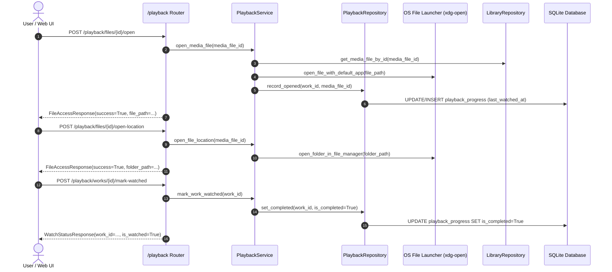

# Implementation Plan - Phase 3: Playback & File Access

This plan defines the simplified, safe, and lightweight design for **Phase 3** of CinemaShelf, based on [`docs/11-implementation-roadmap-fa.md`](../11-implementation-roadmap-fa.md) and user feedback focusing on **safe OS file opening**, **file location revealing**, and **manual watch status management**.

---

## Goal Description

Provide simple, safe, and reliable media access and manual watch tracking:
1. **Open Media File**: Open the local video file using the system default application (e.g. `xdg-open` / default media player).
2. **Open File Location**: Open the containing folder in the native OS file manager (e.g. desktop folder view) for direct user access.
3. **Manual Watched Status**: Allow users to explicitly mark a movie or episode as watched or unwatched without automatic background guessing or position tracking.
4. **Recently Opened & Watched Lists**: Query recently opened works and items manually marked as watched.

---

## User Review Required

> [!NOTE]
> **Simplified Design Based on User Feedback:**
> - **No Automatic Watched Detection**: Playback progress percentages, runtime fractions, and minute-by-minute heartbeats are omitted. The user explicitly controls their watched status.
> - **Safe OS Execution**: Instead of running complex player subprocesses with seek parameters, we use standard, safe system opening (`xdg-open` on Linux, `open` on macOS, `os.startfile` on Windows) to open files and folder locations.

---

## Architectural Workflow & Component Relationships

---

## Proposed Changes

### 1. External OS Launcher: `app/adapters/player/`

#### [NEW] `app/adapters/player/launcher.py`
Safe and minimal OS file and directory opener:
- **Protocol `OSOpenerPort(Protocol)`**:
  - `open_file(file_path: str) -> bool`
  - `open_folder(folder_path: str) -> bool`
- **Implementation `SystemFileOpener`**:
  - Validates that target file or folder exists on disk.
  - On Linux: `subprocess.Popen(["xdg-open", str(path)])` without `shell=True`.
  - On macOS: `subprocess.Popen(["open", str(path)])`.
  - On Windows: `os.startfile(str(path))`.
  - Error handling raises `FileMissingError` if the physical file is not found.

---

### 2. Playback Module: `app/modules/playback/`

#### [MODIFY] `app/modules/playback/schemas.py`
Simplified Pydantic DTO contracts:
- `FileAccessResponse`:
  - `media_file_id: int`
  - `work_id: int`
  - `path: str`
  - `action: str` ("open_file" | "open_location")
  - `success: bool`
- `WatchStatusResponse`:
  - `work_id: int`
  - `episode_id: int | None = None`
  - `is_watched: bool`
  - `last_watched_at: datetime | None = None`
- `WatchedWorkItemResponse`:
  - `id: int`
  - `work_id: int`
  - `episode_id: int | None`
  - `is_completed: bool`
  - `last_watched_at: datetime`

#### [MODIFY] `app/modules/playback/repository.py`
Persistence operations on `PlaybackProgress` (without internal commits):
- `get_progress(work_id: int, episode_id: int | None = None) -> PlaybackProgress | None`
- `get_progress_by_file(media_file_id: int) -> PlaybackProgress | None`
- `save_progress(progress: PlaybackProgress) -> PlaybackProgress`
- `list_watched(limit: int = 50, offset: int = 0) -> Sequence[PlaybackProgress]`
- `list_recently_opened(limit: int = 50, offset: int = 0) -> Sequence[PlaybackProgress]`

#### [MODIFY] `app/modules/playback/service.py`
Business logic and transaction management:
- `open_media_file(media_file_id: int) -> FileAccessResponse`:
  - Retrieves `MediaFile` from `LibraryRepository`.
  - Verifies file exists on disk (raises `FileMissingError` if missing).
  - Calls `OSOpenerPort.open_file(file_path)`.
  - Touches or creates `PlaybackProgress` (`last_watched_at = now()`).
  - Commits transaction.
- `open_work(work_id: int, episode_id: int | None = None) -> FileAccessResponse`:
  - Finds an available `MediaFile` associated with the work/episode.
  - Calls `open_media_file`.
- `open_file_location(media_file_id: int) -> FileAccessResponse`:
  - Finds `MediaFile` and calls `OSOpenerPort.open_folder(parent_directory)`.
- `mark_watched(work_id: int, episode_id: int | None = None) -> PlaybackProgress`:
  - Explicitly marks `is_completed = True`, updates `last_watched_at = now()`.
  - Commits transaction.
- `mark_unwatched(work_id: int, episode_id: int | None = None) -> PlaybackProgress`:
  - Marks `is_completed = False`.
  - Commits transaction.
- `get_watch_status(work_id: int, episode_id: int | None = None) -> PlaybackProgress | None`:
  - Fetches current watch record.
- `list_recently_opened(limit: int = 50, offset: int = 0) -> Sequence[PlaybackProgress]`
- `list_watched(limit: int = 50, offset: int = 0) -> Sequence[PlaybackProgress]`

#### [MODIFY] `app/modules/playback/router.py`
FastAPI HTTP endpoints mounted under `/playback`:
- `POST /playback/files/{id}/open`: Open video file with system default player.
- `POST /playback/works/{id}/open`: Open available file for the given movie/episode.
- `POST /playback/files/{id}/open-location`: Open folder containing file in OS file manager.
- `POST /playback/works/{id}/mark-watched`: Manually mark work as watched.
- `POST /playback/works/{id}/mark-unwatched`: Manually mark work as unwatched.
- `GET /playback/works/{id}/status`: Get watch status of a work.
- `GET /playback/recently-opened`: List recently opened files/works.
- `GET /playback/watched`: List works marked as watched.

---

### 3. Application Wiring: `app/main.py`

#### [MODIFY] `app/main.py`
- Mount `playback_router` on `app` under `/playback`.
