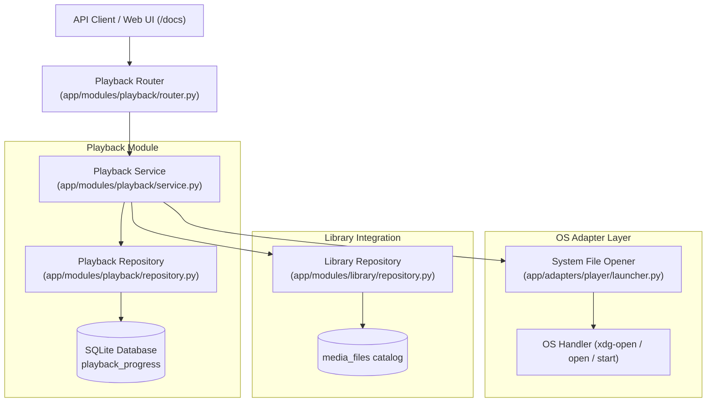

# Walkthrough - Phase 3: Playback & File Access

**Phase 3: Playback & File Access** establishes safe, lightweight OS file and folder launching, combined with clean manual watch status management.

---

## 1. Architectural Overview

---

## 2. Changes Implemented by Component

### A. OS File & Folder Opener Adapter
- **File**: `app/adapters/player/launcher.py`
- **Protocol**: `OSOpenerPort` with methods `open_file(file_path)` and `open_folder(folder_path)`.
- **Implementation**: `SystemFileOpener`
  - Validates physical file / directory existence on disk, raising `FileMissingError` if missing.
  - Cross-platform: Uses `xdg-open` on Linux, `open` on macOS, and `os.startfile` on Windows.
  - Safe execution: Runs detached processes with `start_new_session=True` without `shell=True` to prevent command injection.

### B. Playback Module (`app/modules/playback/`)
- **Schemas (`app/modules/playback/schemas.py`)**:
  - `FileAccessResponse`: Result of open file or open location requests.
  - `WatchStatusResponse`: Clean DTO for current watch state.
  - `WatchedWorkItemResponse`: Detailed ORM-backed DTO for history and listing endpoints.
- **Repository (`app/modules/playback/repository.py`)**:
  - `get_progress(work_id, episode_id)`
  - `get_progress_by_file_id(media_file_id)`
  - `save_progress(progress)`
  - `list_watched(limit, offset)`
  - `list_recently_opened(limit, offset)`
  - `delete_progress(progress)`
- **Service (`app/modules/playback/service.py`)**:
  - `open_media_file(media_file_id)`: Opens the file in the OS default player and records access time (`last_watched_at`). Enforces domain invariant: opening a file does **not** mark it as watched.
  - `open_work(work_id, episode_id)`: Resolves an available media file from the library and opens it.
  - `open_file_location(media_file_id)`: Reveals parent folder in OS file manager.
  - `mark_watched(work_id, episode_id)`: Manually sets `is_completed = True`.
  - `mark_unwatched(work_id, episode_id)`: Manually resets `is_completed = False`.
  - `get_watch_status(work_id, episode_id)`: Returns whether the work is marked watched.
  - `list_watched(...)`, `list_recently_opened(...)`.
- **Router (`app/modules/playback/router.py`)**:
  - Mounted under prefix `/playback` in `app/main.py`.

#### Endpoints Summary:
| Method | Endpoint | Description |
|---|---|---|
| `POST` | `/playback/files/{id}/open` | Opens physical media file with system default player |
| `POST` | `/playback/works/{id}/open` | Opens local media file for the specified movie or episode |
| `POST` | `/playback/files/{id}/open-location` | Reveals the parent folder in the native OS file manager |
| `POST` | `/playback/works/{id}/mark-watched` | Manually marks a film or episode as watched |
| `POST` | `/playback/works/{id}/mark-unwatched` | Manually marks a film or episode as unwatched |
| `GET` | `/playback/works/{id}/status` | Gets current watched status and timestamp |
| `GET` | `/playback/recently-opened` | Lists recently opened works |
| `GET` | `/playback/watched` | Lists works manually marked as watched |

---

## 3. Verification & Test Results

### Automated Test Suite (60 Tests Passed)
Ran `pytest -v`:
- `tests/unit/test_os_opener.py` (4 passed):
  - File opening execution via `subprocess.Popen`
  - Folder revealing via `subprocess.Popen`
  - `FileMissingError` handling for missing files and missing directories
- `tests/unit/test_playback_service.py` (6 passed):
  - Opening media file and verifying `last_watched_at` update while preserving `is_completed == False`
  - Opening work and resolving media files
  - Handling 404s for works with no media files
  - Opening file location in file manager
  - Manual `mark_watched` and `mark_unwatched` toggles
- `tests/integration/test_api_phase3.py` (1 passed):
  - End-to-end HTTP lifecycle from library ingestion to file access, status checks, and watched listing
- All existing Phase 1 & Phase 2 tests (49 passed)
- Total: **60 passed**.

### Quality & Static Checks
- **Ruff Linter**: `All checks passed!`
- **Ruff Formatter**: `122 files already formatted.`
- **Mypy Static Typing**: `Success: no issues found in 86 source files.`
