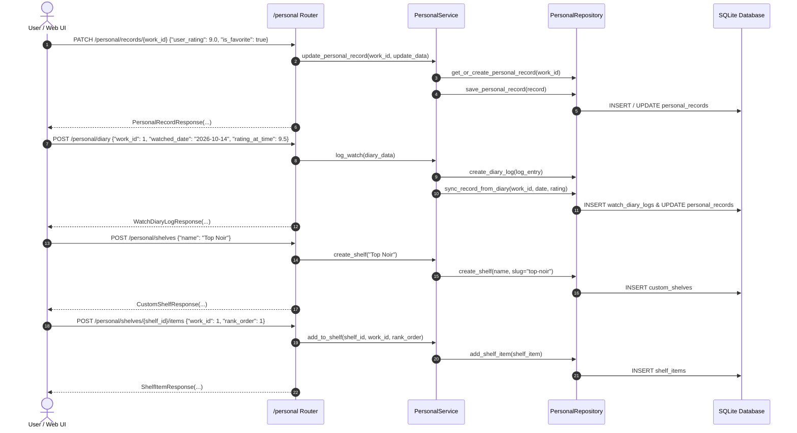

# Implementation Plan - Phase 4: Personalization, Ratings & Custom Lists

This plan defines the architecture, schema contracts, application services, and API endpoints for **Phase 4** of CinemaShelf, based on [`docs/11-implementation-roadmap-fa.md`](../11-implementation-roadmap-fa.md) and [`docs/decisions/0002-domain-invariants.md`](../decisions/0002-domain-invariants.md).

---

## Goal Description

Transform CinemaShelf from a media downloader and player into a **personal cinephile archive and watch diary**:
1. **Personal Records & User State**: Store and update user ratings (0.0 to 10.0), watch status (`UNWATCHED`, `WATCHLIST`, `WATCHING`, `COMPLETED`, `ON_HOLD`, `DROPPED`), watchlist toggles, favorite marks, and personal notes per `MediaWork`.
2. **Watch Diary (Letterboxd Style)**: Enable logging viewings with dates, rewatch tags, specific ratings at the time of viewing, and review notes; automatically update watch count, first watched, and last watched timestamps.
3. **Custom Shelves & Collections**: Create custom curated shelves (e.g., *"Favorite Film Noirs"*, *"Studio Ghibli Rankings"*), add works with custom rank order and notes, and support item reordering.
4. **Personalized Catalog Filtering**: Provide rich filtering and sorting of the library based on user rating, watchlist status, favorites, watch status, and custom shelf memberships.

---

## Architectural Workflow & Component Relationships

---

## Proposed Changes

### 1. Personal Module Contracts: `app/modules/personal/schemas.py`

#### Pydantic DTOs:
- **`PersonalRecordResponse`**:
  - `id: int`
  - `work_id: int`
  - `watch_status: WatchStatus`
  - `in_watchlist: bool`
  - `is_favorite: bool`
  - `user_rating: float | None`
  - `watch_count: int`
  - `personal_notes: str | None`
  - `first_watched_at: date | None`
  - `last_watched_at: date | None`
  - `created_at: datetime`
  - `updated_at: datetime`

- **`PersonalRecordUpdateRequest`**:
  - `watch_status: WatchStatus | None = None`
  - `in_watchlist: bool | None = None`
  - `is_favorite: bool | None = None`
  - `user_rating: float | None = Field(default=None, ge=0.0, le=10.0)`
  - `personal_notes: str | None = None`

- **`RatingRequest`**, **`WatchlistToggleRequest`**, **`FavoriteToggleRequest`**:
  - Minimal payloads for targeted action buttons.

- **`WatchDiaryCreateRequest`**:
  - `work_id: int`
  - `episode_id: int | None = None`
  - `watched_date: date = Field(default_factory=date.today)`
  - `rating_at_time: float | None = Field(default=None, ge=0.0, le=10.0)`
  - `is_rewatch: bool = False`
  - `review_text: str | None = None`
  - `liked: bool = False`

- **`WatchDiaryLogResponse`**:
  - `id: int`
  - `work_id: int`
  - `episode_id: int | None`
  - `watched_date: date`
  - `rating_at_time: float | None`
  - `is_rewatch: bool`
  - `review_text: str | None`
  - `liked: bool`
  - `created_at: datetime`

- **`CustomShelfCreateRequest`** & **`CustomShelfUpdateRequest`**:
  - `name: str = Field(min_length=1, max_length=255)`
  - `description: str | None = None`
  - `is_smart_shelf: bool = False`

- **`ShelfItemCreateRequest`**:
  - `work_id: int`
  - `rank_order: int = 0`
  - `note: str | None = None`

- **`ShelfItemResponse`**:
  - `id: int`
  - `shelf_id: int`
  - `work_id: int`
  - `rank_order: int`
  - `note: str | None`
  - `added_at: datetime`
  - `title: str | None = None`
  - `release_year: int | None = None`
  - `poster_path: str | None = None`

- **`CustomShelfResponse`**:
  - `id: int`
  - `name: str`
  - `slug: str`
  - `description: str | None`
  - `is_smart_shelf: bool`
  - `items_count: int`
  - `created_at: datetime`

- **`CustomShelfDetailResponse`**:
  - Extends `CustomShelfResponse` with `items: list[ShelfItemResponse]`

- **`PersonalWorkCatalogItem`**:
  - `work_id: int`
  - `title: str`
  - `original_title: str | None`
  - `release_year: int | None`
  - `poster_path: str | None`
  - `tmdb_rating: float | None`
  - `imdb_rating: float | None`
  - `personal: PersonalRecordResponse | None`

---

### 2. Personal Module Persistence: `app/modules/personal/repository.py`

Pure query methods without internal commits:
- `get_personal_record(work_id: int) -> PersonalRecord | None`
- `save_personal_record(record: PersonalRecord) -> PersonalRecord`
- `create_diary_log(log: WatchDiaryLog) -> WatchDiaryLog`
- `get_diary_log(log_id: int) -> WatchDiaryLog | None`
- `list_diary_logs(work_id: int | None = None, limit: int = 50, offset: int = 0) -> Sequence[WatchDiaryLog]`
- `delete_diary_log(log: WatchDiaryLog) -> None`
- `create_shelf(shelf: CustomShelf) -> CustomShelf`
- `get_shelf_by_id(shelf_id: int) -> CustomShelf | None`
- `get_shelf_by_slug(slug: str) -> CustomShelf | None`
- `list_shelves() -> Sequence[tuple[CustomShelf, int]]`
- `delete_shelf(shelf: CustomShelf) -> None`
- `add_shelf_item(item: ShelfItem) -> ShelfItem`
- `get_shelf_item(shelf_id: int, work_id: int) -> ShelfItem | None`
- `remove_shelf_item(item: ShelfItem) -> None`
- `get_shelf_items(shelf_id: int) -> Sequence[ShelfItem]`
- `filter_personal_works(...) -> Sequence[tuple[MediaWork, PersonalRecord | None]]`

---

### 3. Personal Module Service: `app/modules/personal/service.py`

Coordinates transactions and business rules:
- `get_or_create_record(work_id: int) -> PersonalRecord`
- `update_personal_record(work_id: int, req: PersonalRecordUpdateRequest) -> PersonalRecordResponse`
- `toggle_watchlist(work_id: int, state: bool | None = None) -> PersonalRecordResponse`
- `toggle_favorite(work_id: int, state: bool | None = None) -> PersonalRecordResponse`
- `set_rating(work_id: int, rating: float | None) -> PersonalRecordResponse`
- `log_watch(req: WatchDiaryCreateRequest) -> WatchDiaryLogResponse`:
  - Increments `watch_count`
  - Sets `last_watched_at` to `watched_date`
  - Sets `first_watched_at` to `watched_date` if not set
  - Marks `watch_status = WatchStatus.COMPLETED` (if previously UNWATCHED or WATCHLIST)
  - Synchronizes rating if provided and not previously set
  - Commits transaction
- `list_diary(...) -> list[WatchDiaryLogResponse]`
- `delete_diary_entry(log_id: int) -> bool`
- `create_shelf(name: str, description: str | None = None, is_smart_shelf: bool = False) -> CustomShelfResponse`
- `list_shelves() -> list[CustomShelfResponse]`
- `get_shelf(shelf_id_or_slug: int | str) -> CustomShelfDetailResponse`
- `update_shelf(shelf_id: int, name: str | None = None, description: str | None = None) -> CustomShelfResponse`
- `delete_shelf(shelf_id: int) -> bool`
- `add_to_shelf(shelf_id: int, work_id: int, rank_order: int = 0, note: str | None = None) -> ShelfItemResponse`
- `remove_from_shelf(shelf_id: int, work_id: int) -> bool`
- `reorder_shelf(shelf_id: int, work_order: list[int]) -> list[ShelfItemResponse]`
- `filter_catalog(...) -> list[PersonalWorkCatalogItem]`

---

### 4. Personal Module Router: `app/modules/personal/router.py`

Mounts endpoints under `/personal`:
- `GET /personal/records/{work_id}`
- `PATCH /personal/records/{work_id}`
- `POST /personal/records/{work_id}/watchlist`
- `POST /personal/records/{work_id}/favorite`
- `POST /personal/records/{work_id}/rate`
- `POST /personal/diary`
- `GET /personal/diary`
- `GET /personal/diary/{log_id}`
- `DELETE /personal/diary/{log_id}`
- `POST /personal/shelves`
- `GET /personal/shelves`
- `GET /personal/shelves/{shelf_id_or_slug}`
- `PATCH /personal/shelves/{shelf_id}`
- `DELETE /personal/shelves/{shelf_id}`
- `POST /personal/shelves/{shelf_id}/items`
- `DELETE /personal/shelves/{shelf_id}/items/{work_id}`
- `PUT /personal/shelves/{shelf_id}/items/reorder`
- `GET /personal/works`

Mount `personal_router` in `app/main.py`.

---

## Verification Plan

### Automated Unit & Integration Tests
1. **`tests/unit/test_personal_service.py`**:
   - `test_get_or_create_personal_record`: Ensure record created with default `UNWATCHED`.
   - `test_rating_validation_and_update`: Validate ratings in `[0.0, 10.0]`.
   - `test_diary_logging_and_record_sync`: Ensure diary entry increments `watch_count`, sets dates, and transitions status to `COMPLETED`.
   - `test_custom_shelf_creation_and_slug`: Ensure unique slug generation.
   - `test_shelf_items_duplicate_rejection`: Ensure duplicate work in same shelf is prevented or updated.
   - `test_shelf_reordering`: Ensure rank orders are updated according to list.
2. **`tests/integration/test_api_phase4.py`**:
   - End-to-end API lifecycle test:
     1. Add movie to library
     2. Update personal record (rate 9.0, mark favorite, add note)
     3. Toggle watchlist
     4. Log viewing in watch diary
     5. Create custom shelf ("Top 10 of All Time")
     6. Add movie to custom shelf
     7. Query filtered catalog (`/personal/works?is_favorite=true&min_rating=8.0`)
     8. Delete shelf item and diary log
3. **Full Quality Checks**:
   - `pytest -v` (All existing 60 tests + Phase 4 tests)
   - `ruff check .`
   - `ruff format --check .`
   - `mypy app tests`
   - `python tests/architecture/test_no_legacy_imports.py`
