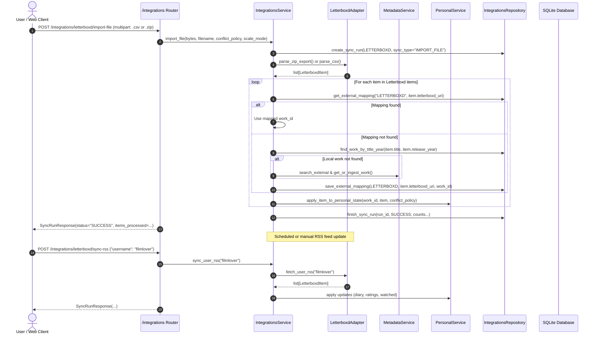

# Implementation Plan - Phase 5: Letterboxd Integrations & Sync

This plan defines the architecture, schema contracts, application services, and API endpoints for **Phase 5** of CinemaShelf, based on [`docs/11-implementation-roadmap-fa.md`](../11-implementation-roadmap-fa.md), [`docs/05-workflows-and-jobs.md`](../05-workflows-and-jobs.md), and [`docs/decisions/0002-domain-invariants.md`](../decisions/0002-domain-invariants.md).

---

## Goal Description

Transform CinemaShelf into an interconnected cinephile hub by integrating with **Letterboxd**:
1. **Multi-Source Letterboxd Import**:
   - **Full ZIP Export**: Parse full Letterboxd data export ZIP archives containing `watchlist.csv`, `watched.csv`, `ratings.csv`, `diary.csv`, and `lists/*.csv`.
   - **Individual CSV Upload**: Import standalone CSVs (standard Letterboxd exports and legacy simplified `Name,Year` format).
   - **Public RSS Feed Sync**: Fetch and parse official Letterboxd user RSS feeds (`https://letterboxd.com/{username}/rss/`) extracting structured diary events, watched films, and ratings.
   - **Watchlist Web/Browser Extraction**: Scrape public watchlists (`https://letterboxd.com/{username}/watchlist/`) with anti-bot protection support via persistent Chrome profile session (`data/profiles/letterboxd`).
2. **Catalog & Identity Resolution**:
   - Match external Letterboxd titles and URIs to internal `MediaWork` entities:
     1. Cached `ExternalItemMapping` lookup (`provider="LETTERBOXD"`, `external_key=uri`).
     2. Local catalog search by normalized title + release year.
     3. External TMDB search and automated ingestion via `MetadataService.get_or_ingest_work` (with graceful offline fallback).
3. **Personal State Synchronization & Conflict Management**:
   - Synchronize `in_watchlist`, `user_rating`, `watch_status`, `WatchDiaryLog` viewings, and `CustomShelf` collections.
   - Enforce domain invariant: **Local manual edits must never be overwritten without explicit user permission** (`ConflictPolicy.PRESERVE_LOCAL` by default).
   - Enforce domain invariant: **Failed or partial sync runs must never delete or mark missing existing personal state or library items**.
   - Create wanted `LibraryItem` records for watchlist entries so they seamlessly enter the JIT download pipeline.
4. **Auditability & Observability**:
   - Persist execution runs in `IntegrationSyncRun` with counts (`items_processed`, `items_created`, `items_updated`, `items_failed`), execution timing, and structured error logs.

---

## User Review Required

> [!IMPORTANT]
> **Conflict Resolution Policy**:
> When a movie already has local personal data (e.g., user rated it 9.0 locally, but Letterboxd has 4.0/5.0), the default policy is `PRESERVE_LOCAL`. The user can optionally pass `conflict_policy="OVERWRITE_LOCAL"` in the API request if they explicitly intend to sync Letterboxd over local changes.

> [!NOTE]
> **Rating Scale Conversion**:
> Letterboxd uses a 5-star scale in 0.5 increments (0.5 to 5.0). CinemaShelf's database supports ratings from 0.0 to 10.0.
> We support a parameter `scale_mode`:
> - `"raw"` (default): Preserves the exact Letterboxd float (e.g. 4.5).
> - `"ten_point"`: Automatically doubles the rating to normalize to a 10-point scale (e.g. 4.5 -> 9.0).

---

## Open Questions

None currently blocking. Both `PRESERVE_LOCAL` and `OVERWRITE_LOCAL`, as well as `raw` and `ten_point` scale modes, are made configurable at the request level with safe, non-destructive defaults.

---

## Architectural Workflow & Component Relationships



---

## Proposed Changes

Grouped by component layer in dependency order:

### 1. Central Configuration (`app/core/config.py`)

#### [MODIFY] [`app/core/config.py`](../../app/core/config.py)
- Add settings for Letterboxd automated background sync:
  - `letterboxd_username: str = ""`
  - `letterboxd_sync_interval_hours: int = 12`
  - `letterboxd_auto_sync_enabled: bool = False`

---

### 2. Letterboxd External Adapter (`app/adapters/letterboxd/`)

#### [MODIFY] [`app/adapters/letterboxd/client.py`](../../app/adapters/letterboxd/client.py)
Implement `LetterboxdClient` complying with `LetterboxdPort`:
- **Models & Dataclasses**:
  - `LetterboxdItemType`: `WATCHLIST`, `WATCHED`, `RATING`, `DIARY`, `LIST`.
  - `LetterboxdItem`:
    ```python
    @dataclass
    class LetterboxdItem:
        title: str
        entry_type: LetterboxdItemType
        release_year: int | None = None
        letterboxd_uri: str | None = None
        rating: float | None = None
        watched_date: date | None = None
        date_logged: date | None = None
        is_rewatch: bool = False
        review_text: str | None = None
        tags: list[str] = field(default_factory=list)
        list_name: str | None = None
        list_rank: int | None = None
    ```
  - `LetterboxdExportArchive`:
    ```python
    @dataclass
    class LetterboxdExportArchive:
        watchlist: list[LetterboxdItem] = field(default_factory=list)
        watched: list[LetterboxdItem] = field(default_factory=list)
        ratings: list[LetterboxdItem] = field(default_factory=list)
        diary: list[LetterboxdItem] = field(default_factory=list)
        lists: dict[str, list[LetterboxdItem]] = field(default_factory=dict)
    ```
- **Methods**:
  - `parse_csv(content: str | bytes, filename: str | None = None) -> list[LetterboxdItem]`:
    Robust CSV parser with flexible header matching (detects `Name`/`Title`/`Film`, `Year`, `Letterboxd URI`/`URL`, `Rating`, `Watched Date`/`Date`, `Rewatch`, `Tags`, `Description`). Handles standard Letterboxd CSV formats (`watchlist.csv`, `watched.csv`, `ratings.csv`, `diary.csv`, custom list CSVs) and simplified legacy CSVs (`Name,Year`).
  - `parse_zip_export(zip_bytes: bytes) -> LetterboxdExportArchive`:
    Inspects archive structure in-memory using `zipfile.ZipFile`, extracting and parsing all standard CSV files and any custom lists under `lists/`.
  - `fetch_user_rss(username: str) -> list[LetterboxdItem]`:
    Fetches `https://letterboxd.com/{username}/rss/` using `httpx.Client` and parses XML with `xml.etree.ElementTree`. Extracts standard elements and custom `letterboxd:*` XML namespaces (`letterboxd:filmTitle`, `letterboxd:filmYear`, `letterboxd:memberRating`, `letterboxd:watchedDate`, `letterboxd:rewatch`).
  - `scrape_watchlist_page(username: str, page: int = 1) -> tuple[list[LetterboxdItem], bool]`:
    Fetches public watchlist HTML; parses poster elements (`data-film-slug`, `data-target-link`, image titles, years) with pagination detection.
  - `launch_browser_session() -> None`:
    Launches Chrome with `letterboxd_profile_dir` using `DrissionPage` for manual user login or CAPTCHA solving.

---

### 3. Integrations Contracts & Persistence Layer (`app/modules/integrations/`)

#### [MODIFY] [`app/modules/integrations/schemas.py`](../../app/modules/integrations/schemas.py)
Define API request/response DTOs:
- `ConflictPolicy(str, Enum)`: `PRESERVE_LOCAL`, `OVERWRITE_LOCAL`.
- `RatingScaleMode(str, Enum)`: `RAW`, `TEN_POINT`.
- `SyncRunResponse`:
  - `id: int`, `provider: IntegrationProvider`, `sync_type: str`, `status: SyncRunStatus`
  - `items_processed: int`, `items_created: int`, `items_updated: int`, `items_failed: int`
  - `started_at: datetime`, `finished_at: datetime | None`, `error_details: dict[str, Any] | None`
- `ExternalItemMappingResponse`:
  - `id: int`, `provider: IntegrationProvider`, `external_key: str`, `work_id: int`, `last_synced_at: datetime`
- `LetterboxdSyncRequest`:
  - `username: str = Field(min_length=1, max_length=100)`
  - `conflict_policy: ConflictPolicy = ConflictPolicy.PRESERVE_LOCAL`
  - `scale_mode: RatingScaleMode = RatingScaleMode.RAW`
  - `max_pages: int = Field(default=5, ge=1, le=50)`
- `ImportSummaryResponse`:
  - Summary of the import batch: sync run status, processed count, created count, updated count, failed count, error list.

#### [MODIFY] [`app/modules/integrations/repository.py`](../../app/modules/integrations/repository.py)
Implement `IntegrationsRepository` (strictly persistence, no `session.commit()`):
- `create_sync_run(provider: IntegrationProvider, sync_type: str) -> IntegrationSyncRun`
- `finish_sync_run(run_id: int, status: SyncRunStatus, items_processed: int, items_created: int, items_updated: int, items_failed: int, error_details: dict[str, Any] | None = None) -> IntegrationSyncRun`
- `get_sync_run(run_id: int) -> IntegrationSyncRun | None`
- `list_sync_runs(provider: IntegrationProvider | None = None, limit: int = 20, offset: int = 0) -> list[IntegrationSyncRun]`
- `get_external_mapping(provider: IntegrationProvider, external_key: str) -> ExternalItemMapping | None`
- `save_external_mapping(mapping: ExternalItemMapping) -> ExternalItemMapping`
- `list_mappings_by_work_id(work_id: int) -> list[ExternalItemMapping]`
- `find_work_by_title_year(title: str, year: int | None = None) -> MediaWork | None`

---

### 4. Integrations Application Service Layer (`app/modules/integrations/service.py`)

#### [MODIFY] [`app/modules/integrations/service.py`](../../app/modules/integrations/service.py)
Implement `IntegrationsService` coordinating transaction boundaries, matching, and invariant enforcement:
- `__init__(session: Session, letterboxd_client: LetterboxdPort | None = None, metadata_service: MetadataService | None = None, personal_service: PersonalService | None = None)`
- **Methods**:
  - `import_file(file_bytes: bytes, filename: str, conflict_policy: ConflictPolicy, scale_mode: RatingScaleMode) -> IntegrationSyncRun`:
    Dispatches to ZIP extractor if `.zip`, or CSV parser if `.csv`.
  - `sync_rss(username: str, conflict_policy: ConflictPolicy, scale_mode: RatingScaleMode) -> IntegrationSyncRun`:
    Fetches RSS and applies updates.
  - `sync_watchlist(username: str, max_pages: int, conflict_policy: ConflictPolicy, scale_mode: RatingScaleMode) -> IntegrationSyncRun`:
    Fetches public watchlist pages and applies updates.
  - `_resolve_media_work(item: LetterboxdItem) -> MediaWork | None`:
    1. Check `ExternalItemMapping` for `(LETTERBOXD, item.letterboxd_uri)`.
    2. Search local DB by title & year.
    3. Search external TMDB via `MetadataService` and call `get_or_ingest_work` (handling provider errors gracefully).
    4. Save `ExternalItemMapping` on resolution.
  - `_apply_item(work: MediaWork, item: LetterboxdItem, conflict_policy: ConflictPolicy, scale_mode: RatingScaleMode) -> tuple[bool, bool]`:
    Updates personal records:
    - If `WATCHLIST`: ensure `LibraryItem` exists (`WANTED`), set `in_watchlist = True`, `watch_status = WATCHLIST` (if unwatched).
    - If `WATCHED`: set `watch_status = COMPLETED`, `watch_count = max(watch_count, 1)`.
    - If `RATING`: apply rating according to `scale_mode` (doubled if `TEN_POINT`). If `conflict_policy == PRESERVE_LOCAL` and rating already set, do not overwrite.
    - If `DIARY`: create `WatchDiaryLog` if no entry exists for this `work_id` on `watched_date` (idempotent).
    - If `LIST`: get/create `CustomShelf` with `item.list_name`, and add work to shelf.
  - Transaction orchestration: Uses commit checkpoints and saves errors in `error_details` so malformed individual items do not abort the overall import batch.

---

### 5. Background Job Handler & Runner Integration (`app/jobs/`)

#### [MODIFY] [`app/jobs/handlers.py`](../../app/jobs/handlers.py)
- Add `sync_letterboxd_feed(session: Session, username: str, conflict_policy: str = "PRESERVE_LOCAL") -> int`:
  Handler to run periodic background updates of user's Letterboxd RSS feed and ingest new diary entries.

#### [MODIFY] [`app/jobs/runner.py`](../../app/jobs/runner.py)
- In `BackgroundJobRunner._run_loop`:
  If `settings.letterboxd_auto_sync_enabled` and `settings.letterboxd_username`, invoke `sync_letterboxd_feed` periodically based on `settings.letterboxd_sync_interval_hours`.

---

### 6. HTTP API Router & App Wiring (`app/modules/integrations/router.py` & `app/main.py`)

#### [MODIFY] [`app/modules/integrations/router.py`](../../app/modules/integrations/router.py)
Expose HTTP endpoints:
- `POST /integrations/letterboxd/import-file`: Multipart file upload for CSV or ZIP.
- `POST /integrations/letterboxd/sync-rss`: Trigger RSS feed synchronization.
- `POST /integrations/letterboxd/sync-watchlist`: Trigger online watchlist synchronization.
- `GET /integrations/sync-runs`: List past sync runs with pagination (`status`, `provider` filters).
- `GET /integrations/sync-runs/{run_id}`: Retrieve detailed sync run audit report.
- `GET /integrations/mappings`: List external item mappings.
- `POST /integrations/letterboxd/browser-session`: Launch Chrome browser session for Letterboxd.

#### [MODIFY] [`app/main.py`](../../app/main.py)
- Include `integrations_router`: `app.include_router(integrations_router)`.

---

## Verification Plan

### Automated Tests
1. **Unit Tests**:
   - `tests/unit/test_letterboxd_adapter.py`:
     - Test CSV parsing of `watchlist.csv`, `watched.csv`, `ratings.csv`, `diary.csv`, and legacy `Name,Year` CSVs.
     - Test ZIP archive extraction and multi-CSV parsing.
     - Test RSS feed XML parsing with mock XML data.
     - Test error cases (malformed CSV, invalid XML, missing columns).
   - `tests/unit/test_integrations_service.py`:
     - Test matching against existing `MediaWork`.
     - Test external provider ingestion fallback.
     - Test conflict policies (`PRESERVE_LOCAL` vs `OVERWRITE_LOCAL`).
     - Test rating scaling (`RAW` vs `TEN_POINT`).
     - Test idempotency (running the same import twice does not duplicate records).
     - Test diary deduplication.
     - Test partial failure handling and `IntegrationSyncRun` metrics.
2. **Integration Tests**:
   - `tests/integration/test_api_phase5.py`:
     - Test `POST /integrations/letterboxd/import-file` with mock CSV file.
     - Test `POST /integrations/letterboxd/import-file` with mock ZIP export.
     - Test `POST /integrations/letterboxd/sync-rss` with mock HTTP response.
     - Test `GET /integrations/sync-runs` and `GET /integrations/sync-runs/{id}`.
     - Test `GET /integrations/mappings`.
3. **Architecture & Linting**:
   - `tests/architecture/test_no_legacy_imports.py` (ensure 0 imports from `legacy/`).
   - Run `/home/javadhm/venv/bin/pytest` (all 72+ tests pass).
   - Run `/home/javadhm/venv/bin/ruff check .` (all clean).
   - Run `/home/javadhm/venv/bin/ruff format --check .` (clean formatting).
   - Run `/home/javadhm/venv/bin/mypy app tests` (0 type issues).

### Manual Verification
- Test importing `legacy/zarfilm-downloader/data/watchlist.csv` via the API endpoint.
- Verify that movies are added to `MediaWork`, given `LibraryItem` with `status=WANTED`, and marked `in_watchlist=True` in `PersonalRecord`.
- Verify database migration compatibility on `cinemashelf.db`.
- Verify full app startup and shutdown lifecycle via `startup_app()` and `shutdown_app()`.
