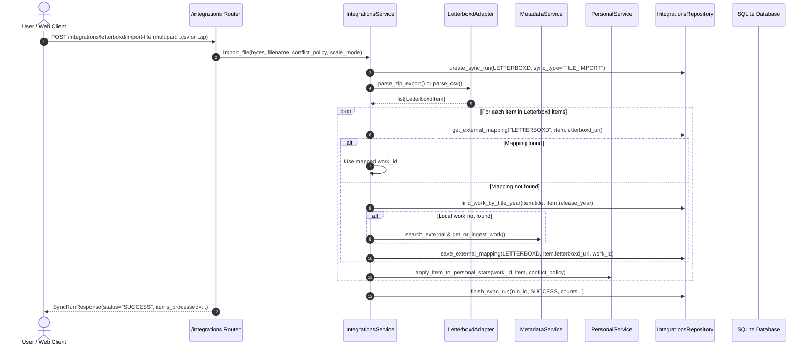

# Implementation Plan - Phase 5: Letterboxd File Import & Sync

This plan defines the architecture, schema contracts, application services, and API endpoints for **Phase 5** of CinemaShelf, scoped specifically to **file-based imports** (excluding live web scraping), based on [`docs/11-implementation-roadmap-fa.md`](../11-implementation-roadmap-fa.md), [`docs/05-workflows-and-jobs.md`](../05-workflows-and-jobs.md), and [`docs/decisions/0002-domain-invariants.md`](../decisions/0002-domain-invariants.md).

---

## Goal Description

Enable robust, offline-friendly import and synchronization of Letterboxd archives from user-supplied files:
1. **Multi-Format File Import**:
   - **Full ZIP Export**: Ingest complete Letterboxd export packages containing `watchlist.csv`, `watched.csv`, `ratings.csv`, `diary.csv`, and any custom list CSVs under `lists/`.
   - **Standalone CSV Files**: Ingest individual files such as `watchlist.csv`, `watched.csv`, `ratings.csv`, `diary.csv`, or simplified legacy CSVs (`Name,Year`).
2. **Catalog & Identity Resolution**:
   - Map external Letterboxd titles and URIs to internal `MediaWork` entities:
     1. Cached `ExternalItemMapping` lookup (`provider="LETTERBOXD"`, `external_key=uri`).
     2. Local catalog search by normalized title + release year.
     3. External TMDB search and automated ingestion via `MetadataService.get_or_ingest_work` (with graceful offline fallback).
3. **Personal State Synchronization & Conflict Management**:
   - Synchronize `in_watchlist`, `user_rating`, `watch_status`, `WatchDiaryLog` viewings, and `CustomShelf` collections.
   - Enforce domain invariant: **Local manual edits must never be overwritten without explicit user permission** (`ConflictPolicy.PRESERVE_LOCAL` by default).
   - Enforce domain invariant: **Failed or partial sync runs must never delete or mark missing existing personal state or library items**.
   - Create wanted `LibraryItem` records for watchlist entries so they seamlessly enter the JIT download pipeline.
4. **Auditability & Observability**:
   - Persist execution runs in `IntegrationSyncRun` with counts (`items_processed`, `items_created`, `items_updated`, `items_failed`), execution timing, and structured error logs.

> [!NOTE]
> Web scraping and live browser sessions have been excluded from this phase per user request. Letterboxd data is ingested exclusively via user export ZIP packages and CSV files.

---

## User Review Required

> [!IMPORTANT]
> **Conflict Resolution Policy**:
> When a movie already has local personal data (e.g., user rated it 9.0 locally, but Letterboxd has 4.0/5.0), the default policy is `PRESERVE_LOCAL`. The user can optionally pass `conflict_policy="OVERWRITE_LOCAL"` in the upload request if they explicitly intend to overwrite local changes.

> [!NOTE]
> **Rating Scale Conversion**:
> Letterboxd uses a 5-star scale in 0.5 increments (0.5 to 5.0). CinemaShelf supports ratings from 0.0 to 10.0.
> The parameter `scale_mode` supports:
> - `"raw"` (default): Preserves the exact Letterboxd float (e.g. 4.5).
> - `"ten_point"`: Automatically doubles the rating to normalize to a 10-point scale (e.g. 4.5 -> 9.0).

---

## Open Questions

None. All decisions regarding scope (file-only), conflict policy (`PRESERVE_LOCAL` default), and rating scale (`raw` default) are established.

---

## Architectural Workflow & Component Relationships



---

## Proposed Changes

Grouped by component layer in dependency order:

### 1. Letterboxd External Adapter (`app/adapters/letterboxd/`)

#### [MODIFY] [`app/adapters/letterboxd/client.py`](../../app/adapters/letterboxd/client.py)
Implement `LetterboxdClient` complying with `LetterboxdPort`:
- **Models & Dataclasses**:
  - `LetterboxdItemType(str, Enum)`: `WATCHLIST`, `WATCHED`, `RATING`, `DIARY`, `LIST`.
  - `LetterboxdItem`:
    ```python
    @dataclass
    class LetterboxdItem:
        title: str
        entry_type: LetterboxdItemType
        release_year: int | None = None
        letterboxd_uri: str | None = None
        rating: float | None = None
        watched_date: date | None = None
        date_logged: date | None = None
        is_rewatch: bool = False
        review_text: str | None = None
        tags: list[str] = field(default_factory=list)
        list_name: str | None = None
        list_rank: int | None = None
    ```
  - `LetterboxdExportArchive`:
    ```python
    @dataclass
    class LetterboxdExportArchive:
        watchlist: list[LetterboxdItem] = field(default_factory=list)
        watched: list[LetterboxdItem] = field(default_factory=list)
        ratings: list[LetterboxdItem] = field(default_factory=list)
        diary: list[LetterboxdItem] = field(default_factory=list)
        lists: dict[str, list[LetterboxdItem]] = field(default_factory=dict)
    ```
- **Port Protocol**:
  ```python
  class LetterboxdPort(Protocol):
      def parse_csv(self, content: str | bytes, filename: str | None = None) -> list[LetterboxdItem]: ...
      def parse_zip_export(self, zip_bytes: bytes) -> LetterboxdExportArchive: ...
  ```
- **Methods**:
  - `parse_csv(content: str | bytes, filename: str | None = None) -> list[LetterboxdItem]`:
    Robust CSV parser with flexible header matching (detects `Name`/`Title`/`Film`, `Year`, `Letterboxd URI`/`URL`, `Rating`, `Watched Date`/`Date`, `Rewatch`, `Tags`, `Description`). Handles standard Letterboxd CSV formats (`watchlist.csv`, `watched.csv`, `ratings.csv`, `diary.csv`, custom list CSVs) and simplified legacy CSVs (`Name,Year`).
  - `parse_zip_export(zip_bytes: bytes) -> LetterboxdExportArchive`:
    Inspects archive structure in-memory using `zipfile.ZipFile`, extracting and parsing all standard CSV files and any custom lists under `lists/`.

---

### 2. Integrations Contracts & Persistence Layer (`app/modules/integrations/`)

#### [MODIFY] [`app/modules/integrations/schemas.py`](../../app/modules/integrations/schemas.py)
Define API request/response DTOs:
- `ConflictPolicy(str, Enum)`: `PRESERVE_LOCAL`, `OVERWRITE_LOCAL`.
- `RatingScaleMode(str, Enum)`: `RAW`, `TEN_POINT`.
- `SyncRunResponse`:
  - `id: int`, `provider: IntegrationProvider`, `sync_type: str`, `status: SyncRunStatus`
  - `items_processed: int`, `items_created: int`, `items_updated: int`, `items_failed: int`
  - `started_at: datetime`, `finished_at: datetime | None`, `error_details: dict[str, Any] | None`
- `ExternalItemMappingResponse`:
  - `id: int`, `provider: IntegrationProvider`, `external_key: str`, `work_id: int`, `last_synced_at: datetime`
- `SyncRunFilterParams`:
  - Optional `provider: IntegrationProvider | None`, `status: SyncRunStatus | None`, `limit: int = 20`, `offset: int = 0`.

#### [MODIFY] [`app/modules/integrations/repository.py`](../../app/modules/integrations/repository.py)
Implement `IntegrationsRepository` (strictly persistence, no `session.commit()`):
- `create_sync_run(provider: IntegrationProvider, sync_type: str) -> IntegrationSyncRun`
- `finish_sync_run(run_id: int, status: SyncRunStatus, items_processed: int, items_created: int, items_updated: int, items_failed: int, error_details: dict[str, Any] | None = None) -> IntegrationSyncRun`
- `get_sync_run(run_id: int) -> IntegrationSyncRun | None`
- `list_sync_runs(provider: IntegrationProvider | None = None, status: SyncRunStatus | None = None, limit: int = 20, offset: int = 0) -> list[IntegrationSyncRun]`
- `get_external_mapping(provider: IntegrationProvider, external_key: str) -> ExternalItemMapping | None`
- `save_external_mapping(mapping: ExternalItemMapping) -> ExternalItemMapping`
- `list_mappings(provider: IntegrationProvider | None = None, limit: int = 50, offset: int = 0) -> list[ExternalItemMapping]`
- `find_work_by_title_year(title: str, year: int | None = None) -> MediaWork | None`

---

### 3. Integrations Application Service Layer (`app/modules/integrations/service.py`)

#### [MODIFY] [`app/modules/integrations/service.py`](../../app/modules/integrations/service.py)
Implement `IntegrationsService` coordinating transaction boundaries, matching, and invariant enforcement:
- `__init__(session: Session, letterboxd_client: LetterboxdPort | None = None, metadata_service: MetadataService | None = None, personal_service: PersonalService | None = None)`
- **Methods**:
  - `import_file(file_bytes: bytes, filename: str, conflict_policy: ConflictPolicy, scale_mode: RatingScaleMode) -> SyncRunResponse`:
    Dispatches to ZIP extractor if `.zip`, or CSV parser if `.csv`.
  - `_resolve_media_work(item: LetterboxdItem) -> MediaWork | None`:
    1. Check `ExternalItemMapping` for `(LETTERBOXD, item.letterboxd_uri)`.
    2. Search local DB by title & year.
    3. Search external TMDB via `MetadataService` and call `get_or_ingest_work` (handling provider errors gracefully).
    4. Save `ExternalItemMapping` on resolution.
  - `_apply_item(work: MediaWork, item: LetterboxdItem, conflict_policy: ConflictPolicy, scale_mode: RatingScaleMode) -> tuple[bool, bool]`:
    Updates personal records:
    - If `WATCHLIST`: ensure `LibraryItem` exists (`WANTED`), set `in_watchlist = True`, `watch_status = WATCHLIST` (if unwatched).
    - If `WATCHED`: set `watch_status = COMPLETED`, `watch_count = max(watch_count, 1)`.
    - If `RATING`: apply rating according to `scale_mode` (doubled if `TEN_POINT`). If `conflict_policy == PRESERVE_LOCAL` and rating already set, do not overwrite.
    - If `DIARY`: create `WatchDiaryLog` if no entry exists for this `work_id` on `watched_date` (idempotent).
    - If `LIST`: get/create `CustomShelf` with `item.list_name`, and add work to shelf.
  - Transaction orchestration: Uses commit checkpoints and saves errors in `error_details` so malformed individual items do not abort the overall import batch.

---

### 4. HTTP API Router & App Wiring (`app/modules/integrations/router.py` & `app/main.py`)

#### [MODIFY] [`app/modules/integrations/router.py`](../../app/modules/integrations/router.py)
Expose HTTP endpoints:
- `POST /integrations/letterboxd/import-file`: Multipart file upload for CSV or ZIP archive.
- `GET /integrations/sync-runs`: List past sync runs with pagination (`status`, `provider` filters).
- `GET /integrations/sync-runs/{run_id}`: Retrieve detailed sync run audit report.
- `GET /integrations/mappings`: List external item mappings.

#### [MODIFY] [`app/main.py`](../../app/main.py)
- Include `integrations_router`: `app.include_router(integrations_router)`.

---

## Verification Plan

### Automated Tests
1. **Unit Tests**:
   - `tests/unit/test_letterboxd_adapter.py`:
     - Test CSV parsing of `watchlist.csv`, `watched.csv`, `ratings.csv`, `diary.csv`, and legacy `Name,Year` CSVs.
     - Test ZIP archive extraction and multi-CSV parsing.
     - Test error cases (malformed CSV, missing columns, empty files).
   - `tests/unit/test_integrations_service.py`:
     - Test matching against existing `MediaWork`.
     - Test external provider ingestion fallback.
     - Test conflict policies (`PRESERVE_LOCAL` vs `OVERWRITE_LOCAL`).
     - Test rating scaling (`RAW` vs `TEN_POINT`).
     - Test idempotency (running the same import twice does not duplicate records).
     - Test diary deduplication.
     - Test partial failure handling and `IntegrationSyncRun` metrics.
2. **Integration Tests**:
   - `tests/integration/test_api_phase5.py`:
     - Test `POST /integrations/letterboxd/import-file` with mock CSV file.
     - Test `POST /integrations/letterboxd/import-file` with mock ZIP export.
     - Test `GET /integrations/sync-runs` and `GET /integrations/sync-runs/{id}`.
     - Test `GET /integrations/mappings`.
3. **Architecture & Linting**:
   - `tests/architecture/test_no_legacy_imports.py` (ensure 0 imports from `legacy/`).
   - Run `/home/javadhm/venv/bin/pytest` (all existing + new tests pass).
   - Run `/home/javadhm/venv/bin/ruff check .` (all clean).
   - Run `/home/javadhm/venv/bin/ruff format --check .` (clean formatting).
   - Run `/home/javadhm/venv/bin/mypy app tests` (0 type issues).

### Manual Verification
- Test importing `legacy/zarfilm-downloader/data/watchlist.csv` via the upload API endpoint.
- Verify that movies are added to `MediaWork`, given `LibraryItem` with `status=WANTED`, and marked `in_watchlist=True` in `PersonalRecord`.
- Verify database migration compatibility on `cinemashelf.db`.
- Verify full app startup and shutdown lifecycle via `startup_app()` and `shutdown_app()`.
