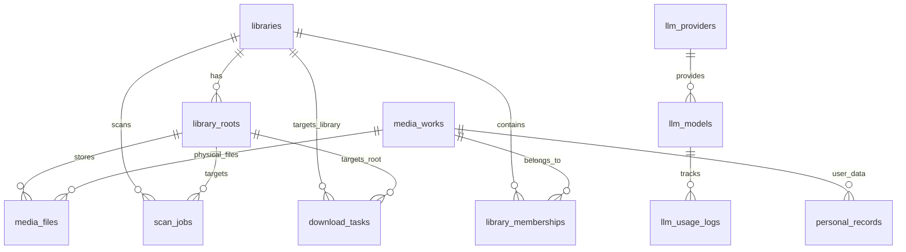
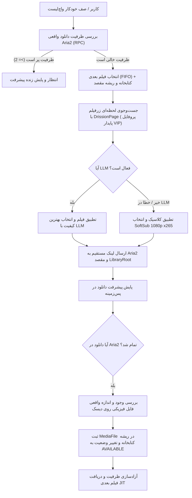

# معماری جامع و نقشهٔ راه دگرگونی CinemaShelf: مدیریت چندکتابخانه‌ای، اسکنر هوشمند و دانلودر یکپارچهٔ JIT

این سند، طرح جامع مهندسی برای ارتقای سامانهٔ **CinemaShelf** از وضعیت فعلی به یک سیستم کامل **«مدیریت چند کتابخانهٔ واقعی + دانلودر یکپارچه»** بر پایهٔ ادغام قابلیت‌های اثبات‌شدهٔ دو پروژهٔ مرجع (`../legacy_CinemaShelf-main` و `../zarfilm-night-scheduler`) درون معماری مدولار، تمیز و پایدار مخزن فعلی است.

---

## ۱. جدول تطبیق مشکلات ۳۵‌گانه و راهکارهای مهندسی

| شماره | بخش | ایراد مطرح‌شده | راهکار معماری و پیاده‌سازی در CinemaShelf جدید |
| :--- | :--- | :--- | :--- |
| **۱** | کتابخانه | نبود مدل چند کتابخانهٔ مستقل (`Library`) | ایجاد مدل و جدول `libraries` (نام، نوع فیلم/سریال، ریشهٔ پیش‌فرض) و جدول واسط `library_memberships`. |
| **۲** | کتابخانه | نبود امکان تعریف ریشه‌های اشتراکی (`LibraryRoot`) | ایجاد جدول `library_roots` متصل به هر کتابخانه با شناسه، مسیر مطلق و نام لیبل. |
| **۳** | کتابخانه | نبود انتخاب پوشه یا مرورگر دایرکتوری در پنل | پیاده‌سازی اندپوینت سرور `GET /api/system/browse-directories` و Modal انتخابگر پوشه در رابط کاربری فرانت‌اند. |
| **۴** | کتابخانه | عدم پیاده‌سازی اسکن واقعی و بازگشتی پوشه‌ها | پیاده‌سازی `LibraryScanner` بازگشتی: فیلتر ویدیوها (`.mkv`, `.mp4`, `.avi`, `.mov`)، فیلتر حجم/نمونه‌ها، کشف خودکار زیرنویس‌ها (`.srt`, `.vtt`). |
| **۵** | کتابخانه | عدم کشف فیلم‌های ناشناختهٔ موجود در هارد | استفاده از الگوریتم استخراج نام/سال از نام فایل (`parse_movie_filename`) و جست‌وجوی خودکار TMDB/OMDb. |
| **۶** | کتابخانه | ذخیرهٔ مسیر مطلق بدون اتصال به ریشه و عدم استفاده از مسیر نسبی | ذخیرهٔ `root_id` و `relative_path` روی `MediaFile`. مسیر فیزیکی کامل به‌صورت پویا از ترکیب `root.mount_path / file.relative_path` تولید می‌شود. |
| **۷** | کتابخانه | عدم تمایز هارد قطع‌شده از فایل حذف‌شده | بررسی وضعیت ریشه: اگر `root.is_online` نادرست باشد، فایل‌ها `offline` تلقی می‌شوند؛ فقط در صورتی که ریشه `online` باشد و فایل وجود نداشته باشد، وضعیت `is_missing=True` ثبت می‌شود. |
| **۸** | کتابخانه | نبود گردش‌کار اصلاح تطبیق دستی فایل با فیلم | ایجاد صف فیلم‌های تطبیق‌نیافته (`unmatched_files`) و اندپوینت اصلاح دستی `POST /api/library/files/{id}/match`. |
| **۹** | فرانت‌اند | ناهمگونی پورت‌های 8080 و 8000 | یکپارچه‌سازی پورت سرور روی 8000 با پروکسی Vite روی `/api` و به‌روزرسانی README و کانفیگ‌ها. |
| **۱۰** | فرانت‌اند | پنهان بودن خطای سرچ زرفیلم و دانلود در Console | افزودن Toast و پیام‌های هشدار قرمز استاندارد در کامپوننت‌های فرانت‌اند (`MovieDetailsPage` و `AddWorkModal`). |
| **۱۱** | فرانت‌اند | برگشت بی‌صدای دکمه دانلود در غیاب `libraryItem` | تضمین ایجاد خودکار `library_item` یا پذیرش دانلود مستقیم با انتخاب کتابخانه و ریشهٔ مقصد. |
| **۱۲** | فرانت‌اند | پنهان شدن قطع بودن Aria2 در اندپوینت آمار | افزودن فیلد `aria2_alive: bool` و `error_message` در اندپوینت آمار و نمایش بج هشدار زرد/قرمز در هدر. |
| **۱۳** | فرانت‌اند | عدم نمایش `error_message` در تسک‌های صف دانلود | رندر پیام خطای فارسی/انگلیسی در کارت تسک صف دانلود در تب واچ‌لیست و صف دانلود. |
| **۱۴** | فرانت‌اند | دکمه پوشه مسیر را کپی می‌کند و پوشه را باز نمی‌کند | اتصال دکمه به اندپوینت `POST /api/playback/open-folder` با اجرای مستقیم فایل‌منیجر سیستم‌عامل (`xdg-open` روی لینوکس). |
| **۱۵** | دانلودر | عدم اتصال تابع روشن کردن Aria2 به شروع برنامه/دانلود | فراخوانی `start_local_daemon()` در `lifespan` استارتاپ و پیش از افزودن هر تسک دانلود. |
| **۱۶** | دانلودر | نبود نصب یا بررسی خودکار نصب Aria2 | بررسی وجود فایل باینری `aria2c` در سیستم‌عامل با لاگ راهنمای نصب (`sudo dnf install aria2` یا `apt`). |
| **۱۷** | دانلودر | عدم اعتبارسنجی اتصال واقعی RPC پس از اجرای daemon | افزودن بررسی RPC با `get_version()` بلافاصله پس از راه‌اندازی و ثبت وضعیت سلامت. |
| **۱۸** | دانلودر | تغییر وضعیت دیتابیس در صورت خطای Aria2 در Pause/Resume | بررسی پاسخ RPC و اعمال تغییر وضعیت تنها در صورت تایید موفقیت عملیات از سوی Aria2. |
| **۱۹** | دانلودر | عدم ثبت تسک خطادار در صورت شکست ارسال اولیه به Aria2 | ثبت رکورد تسک با وضعیت `ERROR` و لاگ دقیق دلیل عدم ارسال در دیتابیس. |
| **۲۰** | دانلودر | نبود انتخاب کتابخانه و ریشهٔ مقصد در فرم دانلود | افزودن انتخابگر کتابخانه و ریشه در مودال دانلود و اعمال مسیر ذخیره‌سازی مناسب. |
| **۲۱** | دانلودر | عدم کنترل تعلق release انتخاب‌شده به همان فیلم | اعتبارسنجی تطابق `work_id` میان رهاورد سرچ و فیلم مقصد در لایه سرویس. |
| **۲۲** | دانلودر | ناقص بودن JIT نسبت به نسخه قدیمی | پیاده‌سازی کامل حلقه JIT از `zarfilm-night-scheduler`: بررسی ظرفیت خالی، سرچ در لحظه، انتخاب کیفیت و شروع دانلود. |
| **۲۳** | دانلودر | ترتیب نزولی به جای FIFO در صف دانلود | اصلاح کوئری انتخاب تسک‌های در انتظار به ترتیب صعودی زمان افزودن (`added_at.asc()`). |
| **۲۴** | دانلودر | محاسبه ظرفیت از دیتابیس به جای اتصالات واقعی Aria2 | کوئری مستقیم از Aria2 RPC برای تعداد واقعی دانلودهای فعال (`num_active`). |
| **۲۵** | دانلودر | توقف پایش پیشرفت در صورت خاموش بودن اسکژولر | تفکیک Worker پایش پیشرفت و وضعیت فایل‌ها از اسکژولر زمان‌بندی شبانه. |
| **۲۶** | دانلودر | تبدیل خودکار به AVAILABLE بدون اعتبارسنجی فایل فیزیکی | بررسی اندازه و صحت فایل پس از پایان دانلود توسط Aria2 پیش از ارتقای وضعیت به `AVAILABLE`. |
| **۲۷** | زرفیلم | نبود وابستگی DrissionPage در نصب معمول | ثبت صریح `DrissionPage` در نیازمندی‌های اصلی بک‌اند و اسکریپت راه‌اندازی. |
| **۲۸** | زرفیلم | عدم انتقال امکانات کروم پایدار، لاگین، LLM و ردیابی هزینه | انتقال کامل ماژول‌های `scraper.py`، `llm_agent.py` و جداول مربوط به پروایدرها و مدل‌های LLM. |
| **۲۹** | لاگ‌ها | نبود پنل مشاهده و پاک‌سازی لاگ‌ها | ایجاد تب اختصاصی «لاگ‌ها و رویدادها» در فرانت‌اند با فیلتر سطح، مرحله و دکمه پاک‌سازی. |
| **۳۰** | لاگ‌ها | عدم ثبت خطاهای کاربردی توسط Exception Handler | ثبت لاگ ساختاریافته در `application_error_handler` همراه با استک‌تریس و مشخصات درخواست. |
| **۳۱** | لاگ‌ها | نبود ساختار تولید `request_id` | افزودن میدل‌ویر اختصاصی تولید و ردیابی `X-Request-ID` در هدر و لاگ‌ها. |
| **۳۲** | لاگ‌ها | بازگشت زودهنگام تنظیمات لاگینگ در صورت وجود هندلر قبلی | بازبینی و بازنویسی کانفیگ لاگینگ در `app/core/logging.py` برای افزودن قطعی FileHandler و ConsoleHandler. |
| **۳۳** | دسته‌بندی | نبود امکانات ساخت میانبر، انتقال فیلم و آمار | انتقال کدهای `categorizer.py` و `stats.py` به ماژول تمیز `app/modules/organizer/`. |
| **۳۴** | آرشیو | محدودیت ۱۰۰ رکورد و نبود صفحه‌بندی کامل | پیاده‌سازی صفحه‌بندی استاندارد (`limit`, `offset`, `total`) در API و رابط کاربری. |
| **۳۵** | آرشیو | واکشی محدود واچ‌لیست و صف دانلود | رفع محدودیت سقف ثابت و اضافه کردن اسکرول یا صفحه‌بندی برای آرشیوهای بزرگ. |

---

## ۲. مدل دادهٔ جدید پایگاه‌داده (Database Schema Blueprint)



### ۲.۱. جداول اصلی کتابخانه و ریشه‌ها (`app/modules/library/models.py`)

```python
class LibraryContentType(str, enum.Enum):
    MOVIE = "MOVIE"
    SHOW = "SHOW"
    MIXED = "MIXED"

class Library(Base, TimestampMixin):
    __tablename__ = "libraries"
    id: Mapped[int] = mapped_column(primary_key=True, autoincrement=True)
    name: Mapped[str] = mapped_column(String(255), unique=True, index=True, nullable=False)
    content_type: Mapped[LibraryContentType] = mapped_column(
        Enum(LibraryContentType), default=LibraryContentType.MOVIE, nullable=False
    )
    default_download_root_id: Mapped[int | None] = mapped_column(
        ForeignKey("library_roots.id", ondelete="SET NULL"), nullable=True
    )
    preferred_language: Mapped[str] = mapped_column(String(10), default="fa")
    
    roots: Mapped[list["LibraryRoot"]] = relationship(
        "LibraryRoot", back_populates="library", cascade="all, delete-orphan", foreign_keys="LibraryRoot.library_id"
    )
    memberships: Mapped[list["LibraryMembership"]] = relationship(
        "LibraryMembership", back_populates="library", cascade="all, delete-orphan"
    )

class LibraryRoot(Base, TimestampMixin):
    __tablename__ = "library_roots"
    id: Mapped[int] = mapped_column(primary_key=True, autoincrement=True)
    library_id: Mapped[int] = mapped_column(
        ForeignKey("libraries.id", ondelete="CASCADE"), index=True, nullable=False
    )
    label: Mapped[str] = mapped_column(String(255), nullable=False)
    mount_path: Mapped[str] = mapped_column(String(1000), unique=True, index=True, nullable=False)
    is_online: Mapped[bool] = mapped_column(Boolean, default=True, index=True)
    is_writable: Mapped[bool] = mapped_column(Boolean, default=True)
    used_bytes: Mapped[int | None] = mapped_column(BigInteger, default=0)
    total_bytes: Mapped[int | None] = mapped_column(BigInteger, default=0)
    last_scanned_at: Mapped[datetime | None] = mapped_column(DateTime(timezone=True), nullable=True)

    library: Mapped["Library"] = relationship("Library", back_populates="roots", foreign_keys=[library_id])
    media_files: Mapped[list["MediaFile"]] = relationship("MediaFile", back_populates="root")

class LibraryMembership(Base, TimestampMixin):
    __tablename__ = "library_memberships"
    id: Mapped[int] = mapped_column(primary_key=True, autoincrement=True)
    library_id: Mapped[int] = mapped_column(ForeignKey("libraries.id", ondelete="CASCADE"), index=True, nullable=False)
    work_id: Mapped[int] = mapped_column(ForeignKey("media_works.id", ondelete="CASCADE"), index=True, nullable=False)
    added_at: Mapped[datetime] = mapped_column(DateTime(timezone=True), default=lambda: datetime.now(UTC))

    __table_args__ = (UniqueConstraint("library_id", "work_id", name="uq_library_membership_lib_work"),)
```

### ۲.۲. اصلاح جدول فایل‌های فیزیکی (`media_files`)
```python
class MediaFile(Base, TimestampMixin):
    __tablename__ = "media_files"
    id: Mapped[int] = mapped_column(primary_key=True, autoincrement=True)
    work_id: Mapped[int] = mapped_column(ForeignKey("media_works.id", ondelete="CASCADE"), index=True, nullable=False)
    root_id: Mapped[int] = mapped_column(ForeignKey("library_roots.id", ondelete="CASCADE"), index=True, nullable=False)
    relative_path: Mapped[str] = mapped_column(String(1000), index=True, nullable=False)
    file_name: Mapped[str] = mapped_column(String(500), nullable=False)
    file_size_bytes: Mapped[int | None] = mapped_column(BigInteger, nullable=True)
    resolution: Mapped[str | None] = mapped_column(String(50), nullable=True)
    video_codec: Mapped[str | None] = mapped_column(String(50), nullable=True)
    source_type: Mapped[str | None] = mapped_column(String(50), nullable=True)
    subtitle_paths: Mapped[list[str] | None] = mapped_column(JSON, default=list)
    has_soft_sub: Mapped[bool] = mapped_column(Boolean, default=False)
    is_missing: Mapped[bool] = mapped_column(Boolean, default=False, index=True)
    last_verified_at: Mapped[datetime | None] = mapped_column(DateTime(timezone=True), nullable=True)

    root: Mapped["LibraryRoot"] = relationship("LibraryRoot", back_populates="media_files")
    work: Mapped["MediaWork"] = relationship("MediaWork", back_populates="media_files")

    @property
    def absolute_path(self) -> Path:
        return Path(self.root.mount_path) / self.relative_path
```

### ۲.۳. جدول پایش اسکن پوشه‌ها (`scan_jobs`)
```python
class ScanJob(Base, TimestampMixin):
    __tablename__ = "scan_jobs"
    id: Mapped[int] = mapped_column(primary_key=True, autoincrement=True)
    library_id: Mapped[int] = mapped_column(ForeignKey("libraries.id", ondelete="CASCADE"), index=True)
    root_id: Mapped[int | None] = mapped_column(ForeignKey("library_roots.id", ondelete="SET NULL"), nullable=True)
    status: Mapped[str] = mapped_column(String(50), default="RUNNING") # RUNNING, COMPLETED, FAILED, CANCELLED
    files_discovered: Mapped[int] = mapped_column(Integer, default=0)
    files_imported: Mapped[int] = mapped_column(Integer, default=0)
    files_unmatched: Mapped[int] = mapped_column(Integer, default=0)
    error_message: Mapped[str | None] = mapped_column(Text, nullable=True)
    started_at: Mapped[datetime] = mapped_column(DateTime(timezone=True), default=lambda: datetime.now(UTC))
    completed_at: Mapped[datetime | None] = mapped_column(DateTime(timezone=True), nullable=True)
```

### ۲.۴. جداول LLM و هزینه‌ها (`app/modules/llm/models.py`)
```python
class LlmProvider(Base, TimestampMixin):
    __tablename__ = "llm_providers"
    id: Mapped[int] = mapped_column(primary_key=True, autoincrement=True)
    name: Mapped[str] = mapped_column(String(100), unique=True, nullable=False)
    base_url: Mapped[str] = mapped_column(String(500), nullable=False)
    api_key: Mapped[str | None] = mapped_column(String(500), nullable=True)
    is_enabled: Mapped[bool] = mapped_column(Boolean, default=True)

class LlmModel(Base, TimestampMixin):
    __tablename__ = "llm_models"
    id: Mapped[int] = mapped_column(primary_key=True, autoincrement=True)
    provider_id: Mapped[int] = mapped_column(ForeignKey("llm_providers.id", ondelete="CASCADE"), nullable=False)
    model_name: Mapped[str] = mapped_column(String(150), nullable=False)
    priority: Mapped[int] = mapped_column(Integer, default=1)
    input_price_per_1m: Mapped[float] = mapped_column(Float, default=0.0)
    output_price_per_1m: Mapped[float] = mapped_column(Float, default=0.0)
    is_enabled: Mapped[bool] = mapped_column(Boolean, default=True)

class LlmUsageLog(Base, TimestampMixin):
    __tablename__ = "llm_usage_logs"
    id: Mapped[int] = mapped_column(primary_key=True, autoincrement=True)
    agent_type: Mapped[str] = mapped_column(String(50), nullable=False) # SEARCH_MATCH, QUALITY_SELECT
    provider_name: Mapped[str] = mapped_column(String(100), nullable=False)
    model_name: Mapped[str] = mapped_column(String(150), nullable=False)
    prompt_tokens: Mapped[int] = mapped_column(Integer, default=0)
    completion_tokens: Mapped[int] = mapped_column(Integer, default=0)
    cost_usd: Mapped[float] = mapped_column(Float, default=0.0)
    is_success: Mapped[bool] = mapped_column(Boolean, default=True)
```

---

## ۳. گردش‌کارهای اصلی سامانه (Core Workflows)

### ۳.۱. افزودن کتابخانه و انتخاب مسیر از سرور (Directory Browser)
1. **مرور پوشه:** کاربر روی دکمهٔ «انتخاب پوشه» کلیک می‌کند؛ کامپوننت مودال، اندپوینت `GET /api/system/browse-directories?path=/home/javadhm` را فراخوانی می‌کند.
2. سرور زیرپوشه‌ها، نام دایرکتوری، دسترسی خواندن/نوشتن و فضای دیسک را برمی‌گرداند.
3. کاربر مسیر مورد نظر را انتخاب و دکمهٔ «تایید و افزودن ریشه» را می‌زند.
4. سرور رکورد `LibraryRoot` را ثبت و اسکن اولیه را آغاز می‌کند.

### ۳.۲. اسکن هوشمند، تطبیق خودکار و تفکیک هارد آفلاین
1. اسکنر `LibraryScanner` به‌صورت بازگشتی در ریشه مشخص‌شده پیمایش می‌کند.
2. فایلهای کمتر از ۲۰۰ مگابایت یا پسوندهای غیرویدیویی نادیده گرفته می‌شوند.
3. با ابزار `parse_movie_filename` عنوان و سال از رشتهٔ نام فایل استخراج می‌شود (پشتیبانی از فرمت‌های `Title.Year.1080p.BluRay.x265.mkv`).
4. فایل‌های زیرنویس همنام (`Title.Year.srt` یا زیرپوشه `Subs/`) شناسایی و ثبت می‌شوند.
5. جست‌وجوی متادیتا در TMDB / OMDb برای یافتن `MediaWork` انجام می‌شود:
   - اگر پیدا شد: عضویت در کتابخانه (`LibraryMembership`) ثبت شده و رکورد `MediaFile` با `relative_path` ذخیره می‌گردد.
   - اگر عنوان مبهم باشد: در جدول `unmatched_files` ثبت می‌شود تا کاربر در پنل با یک کلیک فیلم صحیح را انتخاب کند.
6. **مکانیسم سلامت درایو:** پیش از اسکن، در دسترس بودن `mount_path` با `os.path.exists` بررسی می‌شود. در صورت عدم دسترسی، `root.is_online = False` می‌شود و وضعیت فیلم‌ها بدون تغییر باقی می‌ماند (هیچ فایلی حذف یا Missing نمی‌شود).

### ۳.۳. گردش‌کار یکپارچه دانلود JIT (Zarfilm + Aria2 + Library Auto-Import)


---

## ۴. برنامه و فازبندی پیاده‌سازی (Implementation Roadmap)

### فاز ۱: تصحیح اتصالات، لاگینگ و زیرساخت RPC
- [ ] بازنویسی لاگر در `app/core/logging.py` با پشتیبانی از فایل، کنسول و میدل‌ویر `X-Request-ID`.
- [ ] اعتبارسنجی واقعی Aria2 RPC و اصلاح اندپوینت‌های آمار برای انعکاس دقیق قطعی به UI.
- [ ] راه‌اندازی خودکار `start_local_daemon()` و ثبت لاگ‌های باینری و بررسی سلامت.

### فاز ۲: مدل چندکتابخانه‌ای، ریشه‌ها و مرورگر پوشه
- [ ] ایجاد مدل‌های `Library`, `LibraryRoot`, `LibraryMembership` و مهاجرت Alembic.
- [ ] پیاده‌سازی اندپوینت‌های CRUD کتابخانه و ریشه‌ها در `app/modules/library/router.py`.
- [ ] پیاده‌سازی اندپوینت `GET /api/system/browse-directories` برای انتخاب مسیرهای هارد در سرور.
- [ ] ساخت صفحه و مودال‌های مدیریت کتابخانه‌ها در فرانت‌اند (`LibrariesPage.tsx`).

### فاز ۳: اسکنر واقعی دیسک و تطبیق فایل‌ها
- [ ] انتقال کدهای پارسر و پیاده‌سازی `LibraryScanner` بازگشتی با استخراج متادیتا و زیرنویس‌ها.
- [ ] پیاده‌سازی صف و رابط کاربری تطبیق دستی فایل‌های ناشناخته (`ManualMatchModal.tsx`).
- [ ] محافظت از هاردهای قطع‌شده با پرچم `is_online` و تفکیک قطعی از مفقودی.

### فاز ۴: ادغام دانلودر هوشمند JIT و صف شبانه
- [ ] انتقال ماژول `scraper.py` با `DrissionPage` و اتصال به پروفایل کروم پایدار.
- [ ] پیاده‌سازی سرویس JIT Queue با بررسی ظرفیت واقعی Aria2 و انتخاب FIFO.
- [ ] اتصال دانلودها به کتابخانه و ریشهٔ مشخص، اعتبارسنجی فایل فیزیکی پس از دانلود و ثبت خودکار در کتابخانه.
- [ ] افزودن دکمه‌های کنترل کلی صف (`Pause All`, `Resume All`, `Purge`).

### فاز ۵: ایجنت چندمدلی LLM، سازمان‌دهی و آمار
- [ ] ایجاد ماژول مدیریت پروایدرها و مدل‌های LLM، محاسبه هزینه توکن و Failover خودکار.
- [ ] انتقال الگوریتم‌های میانبردهی و سازمان‌دهی فیزیکی/مجازی از `categorizer.py`.
- [ ] پیاده‌سازی داشبورد تحلیلی و آماری آرشیو بر اساس `stats.py`.
- [ ] پیاده‌سازی تب لاگ‌های سیستم با قابلیت فیلتر مرحله و سطح.

### فاز ۶: صفحه‌بندی کامل و اعتبارسنجی نهایی
- [ ] اضافه کردن صفحه‌بندی کامل در تمام لیست‌های فرانت‌اند برای پشتیبانی از آرشیوهای بالای ۱۰۰۰ اثر.
- [ ] اجرای کامل تست‌های واحد، تست‌های یکپارچگی و تست دود (Smoke Test) روی دیتابیس واقعی.
